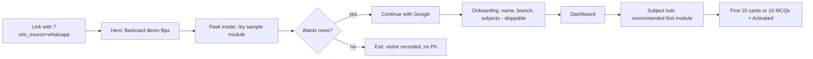
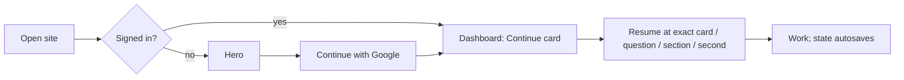
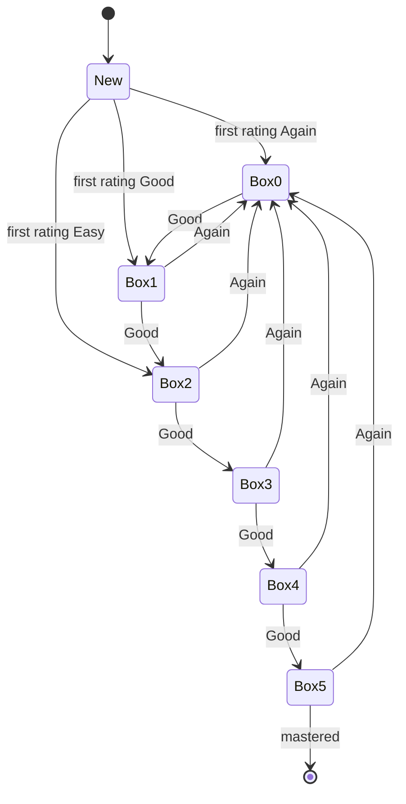
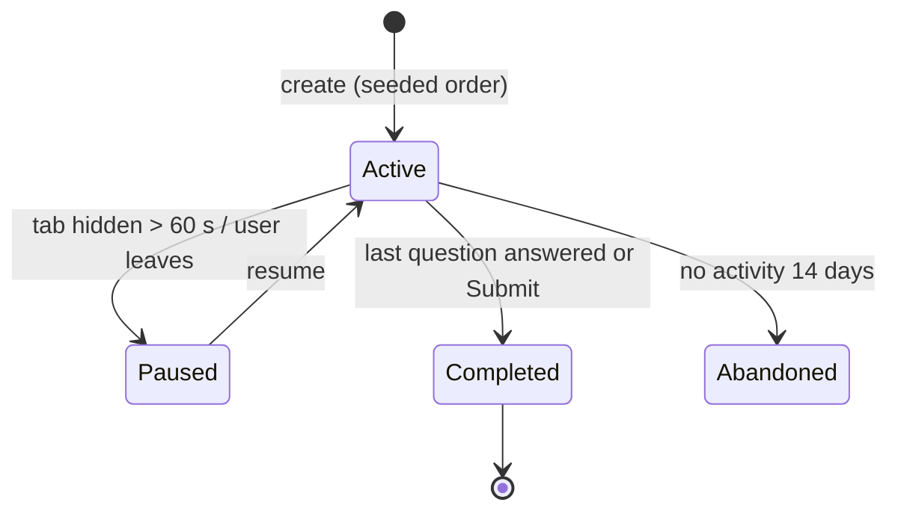
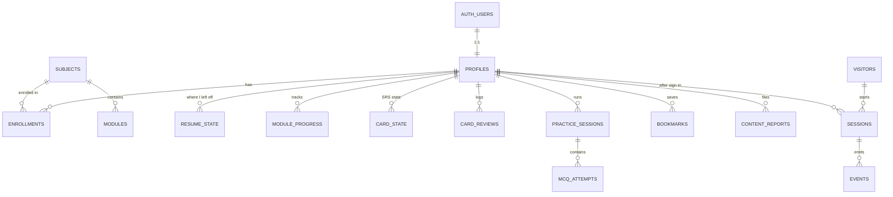
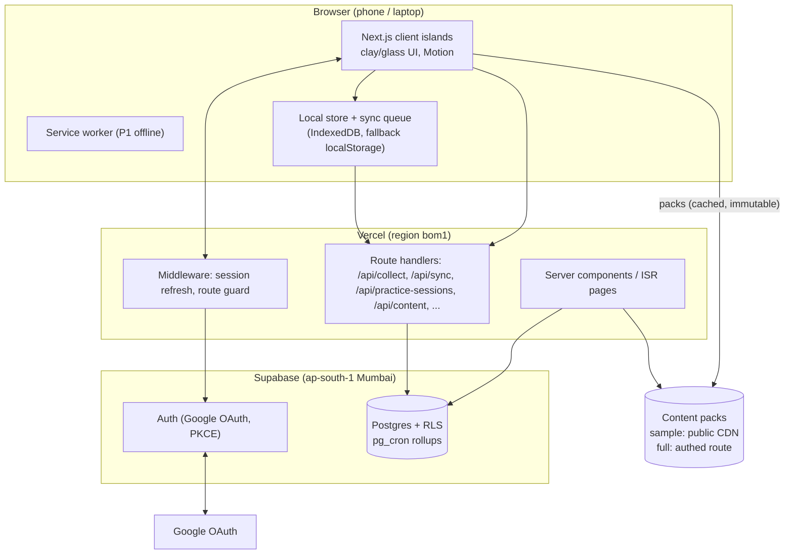
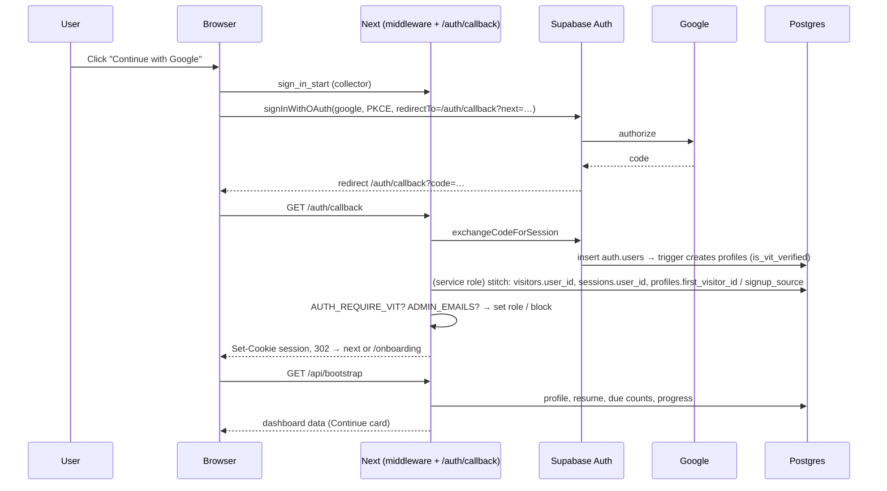
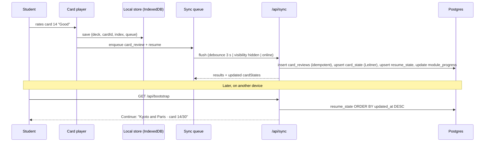
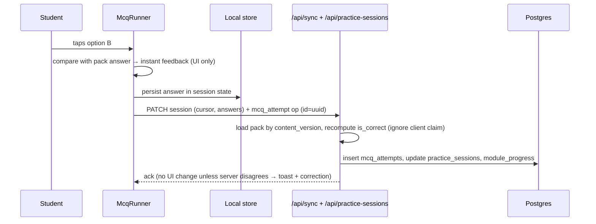
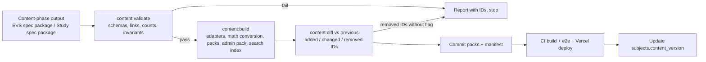

# ClayPrep — Product Requirements Document (PRD v1.0)

> **Working name:** ClayPrep (placeholder; change in one file, `config/brand.ts`).
> **One line:** A soft-touch, claymorphic revision platform for VIT students: flashcards, predicted MCQs and short study notes for **EVS**, **Quantitative Skills 1.0** and **Qualitative Skills 1.0**, with Google sign-in, resume-where-you-left-off, and first-party analytics good enough to put on a CV.
> **Audience for this file:** (1) the owner, to review and approve; (2) **Claude Code**, to build from. Section 15 is the copy-paste master prompt.
> **Status:** Ready for build after the owner confirms the decisions in §1.8 (every one has a safe default, so building can start without answers).

---

## 0. Document control and how to use this file

| Item | Value |
|---|---|
| Version | 1.0 |
| Inputs | `EVS_CAT2_CONTENT_SPEC.md`, `STUDY_CONTENT_SPEC.md` (Quant + Qual), `EVSCat2_merged.pdf` (454 pp), `merged_presentation_choladeck.pdf` (1,006 pp), hero layout reference image |
| Not in this file | The study content itself (cards, MCQs, notes). Those come from the two content specs. This PRD defines how the website consumes them |
| Conventions | **MUST / SHOULD / MAY** are used in the RFC sense. Requirement IDs (`FR-xx`, `NFR-xx`, `D-xx`) are stable. Reference them in commits and PRs |
| Reading order for Claude Code | §0 → §1.8 → §2 → §5 → §7 → §9 → §11 → §13 → §15 |

### Table of contents
1. Idea · 2. PRD (users, scope tiers, functional and non-functional requirements) · 5. Content mapping · 6. Information architecture · 7. UI/UX requirements (incl. hero spec) · 8. Design flow · 9. Database schema · 10. Analytics and tracking · 11. TRD · 12. Technical flows · 13. Implementation plan · 14. Risks · 15. Master prompt for Claude Code · Appendices A–E
(Section numbers 3 and 4 are intentionally unused so that numbers match the ten parts you asked for.)

---

## 1. IDEA

### 1.1 The problem
College students at VIT revise for short, high-stakes, MCQ-based CBT exams from **hundreds of pages of slides and PDFs** (454 pages for EVS, 1,006 for Quant/Qual). Today that means WhatsApp PDFs, no way to tell what matters, no practice in the exam's own format, and no memory of where they stopped.

### 1.2 The idea
One calm, fast, mobile-first site where each subject is already **distilled and organised**:

- **Flashcards** that start from a *situation* ("same distance, two speeds…") and end in a formula plus the trap, not just a term and a definition.
- **Predicted MCQs** (200 per content spec, plus 40 bonus) shown in the exam's own format, with the **answer and layered solution directly in front of each question**.
- **Short notes** (5–8 min per module) that teach before the practice starts.
- **Resume anywhere**: close the laptop mid-card, open the phone, land on the same card.
- **Honest progress**: what you have actually covered, per module, per subject.

### 1.3 Why this wins over "a folder of PDFs"
| PDF folder | ClayPrep |
|---|---|
| 1,460 pages, no priority | ~480 curated MCQs and ~730 cards ranked by evidence-weighted "predicted" score |
| Read-only | Active recall (flashcards with spaced repetition) and exam-format drills |
| Answers at the back of the file | Answer and solution next to the question, or hidden for self-test (cover mode) |
| No memory | Server-side resume + per-module progress |
| Desktop-only reading | Designed for a phone in a hostel corridor at 11 pm |

### 1.4 Product principles
1. **Calm, tactile, quick.** Soft clay objects you want to press; every interaction answers in under 100 ms.
2. **Content first.** The hero and the app both show *real* cards and *real* questions, never stock imagery.
3. **No pressure mechanics.** No streak counters, no guilt notifications. (The Quant content spec records that daily-routine/streak features were *dropped by the owner*. Respect that everywhere.)
4. **Honest about "predicted".** There are no past papers in the source. "Predicted" means evidence-weighted estimate. A visible "How this was chosen" page explains the method (see §2.3 FR-Q10).
5. **Mobile is the primary device.** Desktop is a first-class, not an afterthought, but every flow is designed at 390 px width first.
6. **Extensible by data.** Adding subject #4 is a content drop plus a config entry, with no code change (see §5.6).
7. **Measure everything that matters, collect nothing that does not.** First-party analytics, no third-party trackers, no raw IPs.

### 1.5 What this is not
Not a video-streaming platform (video is P1), not a social network, not a marketplace, not a leaderboard app, not a replacement for attending class. Not affiliated with VIT; no VIT logo or branding is used.

### 1.6 Positioning and tone of voice
- **Audience voice:** a sharp senior who has been through CAT-2. Specific, warm, slightly dry. Never "unlock your potential", never exclamation marks in UI labels, never emoji as icons.
- **Sample copy** (use as the style guide, full copy deck in Appendix D):
  - H1: *Revise what the exam actually asks.*
  - Sub: *Flashcards, predicted MCQs and six-minute notes for EVS, Quantitative and Qualitative Skills, with the answer printed right under each question.*
  - Empty state: *Nothing due. Go do the Predicted 200 for Kyoto and Paris.*
  - Wrong answer: *Close. You used the train's length only. Add the platform.*

### 1.7 Success metrics

**Product metrics (what the dashboard tracks)**
| Metric | Definition | Launch-month target (adjust after real data) |
|---|---|---|
| Sign-ups | Distinct profiles created | 300 |
| Activation | % of sign-ups who review ≥ 10 cards **or** answer ≥ 10 MCQs in session 1 | ≥ 55 % |
| D7 return | % of a signup cohort active on day 7 ± 1 | ≥ 25 % |
| Resume use | % of returning sessions that start via "Continue" | ≥ 50 % |
| Practice volume | Total MCQs answered; cards reviewed | tracked, no target |
| Accuracy delta | Accuracy in a module, first 20 attempts vs next 20 | positive |
| Content quality | % of MCQs with ≥ 1 report | < 3 % |

**CV metrics (what `/stats` and the admin "CV kit" export; see §10.6)**
Registered students · weekly/monthly active · total questions answered · cards reviewed · total study hours · countries/cities reached · Lighthouse scores · uptime · p75 LCP.

### 1.8 Decisions already made (change any before M0; defaults apply if you stay silent)

| ID | Decision | Default | Why / how to change |
|---|---|---|---|
| **D-01** | Product name | **ClayPrep** | Placeholder. One config file, no hard-coded strings elsewhere |
| **D-02** | Stack | **Next.js (App Router) + TypeScript + Tailwind + Supabase (Auth, Postgres) + Vercel** | Best free-tier fit, one language end to end, excellent CV signal. Alternatives (Firebase, Remix, Astro) were rejected: weaker relational analytics (Firebase) or more glue code |
| **D-03** | Auth | **Google sign-in only** via Supabase Auth. Any Google account may sign up. Accounts on `@vitstudent.ac.in` get `is_vit_verified = true` and a "VIT" chip | Flag `AUTH_REQUIRE_VIT=true` locks signup to VIT domains instantly. **Confirm the exact student domain with a classmate before launch** |
| **D-04** | Content delivery | **Versioned immutable JSON "content packs"** (sample module public on the CDN; full packs served only to signed-in users, cached privately). The database stores *user data only*, referencing the content specs' stable IDs (`Q-M05-004`, `MCQ-TSD-014`). Both specs promise IDs never change, so no content mirroring is needed | Keeps DB tiny (free tier), makes offline/PWA trivial, makes adding subjects a file drop |
| **D-05** | Guests | Landing, hero demos and **one free sample module per subject** work without login. Everything else needs sign-in. Guest progress lives in local storage and **merges into the account at first login** | Drives sign-ups, keeps user counts meaningful |
| **D-06** | Analytics | **First-party** event collector into Postgres + Vercel Web Analytics for anonymous traffic. No Google Analytics, no ad pixels. No raw IP stored | Privacy-clean, CV-grade numbers, no consent-banner trauma |
| **D-07** | Spaced repetition | **5-box Leitner** (explainable to students) | Simple to reason about, easy to test |
| **D-08** | Gamification | **None** (no streaks, XP, leaderboards) | Matches owner's earlier decision. Progress rings and "covered" counts only |
| **D-09** | Themes | **Light "Dawn" at launch.** Dark "Dusk" is P1 (tokens are built for it from day one) | Claymorphism is hardest to get right in dark; do it properly later |
| **D-10** | Video | **P1.** The EVS spec defines a ~136-min chalkboard video, which does not exist yet. The data model and player slot are reserved now | Do not block launch on a render pipeline |
| **D-11** | Subject slugs | `evs` · `quantitative-1` · `qualitative-1` | Display names: "EVS", "Quantitative Skills 1.0", "Qualitative Skills 1.0" |
| **D-12** | Hosting | Free tiers (Vercel Hobby, Supabase Free) with the mitigations in §14 | Upgrade path documented. Note Vercel Hobby is for non-commercial use, fine for a student project |
| **D-13** | Language | English (Indian English spelling: *organise*, *programme*, *₹*) | |
| **D-14** | Disclaimer | Footer + About: "Independent student project. Not affiliated with VIT. Content is paraphrased study aid." | Reduces takedown risk (§14 R-01) |
| **D-15** | Admin access | Role `admin` granted to emails in env var `ADMIN_EMAILS` (set at deploy; never committed) | |

### 1.9 Observations on the two content specs (read before building)

These are real inconsistencies Claude Code must not "fix" silently. **Build from the manifest, never from hard-coded numbers.**

1. **Module count mismatch in the Study spec.** TL;DR says "≈ 27" notes; the catalogue (§4 of that spec) defines **20 modules** (10 quant + 4 verbal + 3 logic + 3 soft skills). The site MUST read module lists from `manifest.json`.
2. **The Study spec says "three content types" but the brief mentions "2" twice.** Assumption A1 there (third type = Study Notes) is adopted here.
3. **Two different ID schemes and schemas.** EVS uses `Q-M05-004 / C-M05-0011 / F-… / S-…`; Quant/Qual use `MCQ-TSD-014 / FC-TSD-007 / NOTE-QA-TSD`. §5.3 defines the normalising adapters.
4. **EVS has no "notes" type** (it has a video and ★ facts). The EVS module page therefore uses a **"Cheat sheet" built from ★ facts** (P1) and reference sheets (timeline, SDG wall, Acts and sections, confusables). See §5.4.
5. **EVS "conflict" items (C-01…C-13)** carry `pinned_to_notes`, `verify_with_faculty`, `conflict_id`. These are *internal QA flags*. Students see only a small "per lecture notes" chip on pinned stems; `verify_with_faculty` is admin-only (spec §10.2 Q6 default).
6. **Quant/Qual answer-in-front** is a first-class display mode, not just a print view (§2.3 FR-Q3).
7. **Option order is fixed at build time** (seeded shuffle with letter balance enforced by content validators). The UI MUST NOT re-shuffle options; solutions refer to letters.
8. **Math is stored as plain text** (`x^2`, `a/b`, `₹`). The UI owns rendering (§7.9 and §11.7).
9. **Set questions.** Seating, blood-relation and RC items are authored as *sets* (one scenario → 2–4 or 5 questions). The data model needs a question-group concept (§9, `group` in the content contract).
10. **Gaps the specs deliberately leave out** (Time & Work, Probability, P&C, Number System, Ratio, Syllogisms, DI, Clocks/Calendars). They are not part of this build.

---

## 2. PRD

### 2.1 Users and jobs-to-be-done

| Persona | Who | Context | Job |
|---|---|---|---|
| **Aarav, the night-before crammer** | 1st/2nd year, phone-first | Hostel, 11 pm, exam at 9 am | "Give me the 200 most likely questions with answers, now." |
| **Meera, the planner** | Starts a week early, laptop + phone | Library, then bus | "Tell me what to study in what order, and remember where I stopped." |
| **Karan, the weak-spot fixer** | Failed a mock, anxious about Quant | Tests himself | "Show me what I keep getting wrong and why." |
| **Owner/admin** | You | Phone + laptop | "How many students used it, who, from where, doing what? Show it to a recruiter." |

### 2.2 Scope tiers

| Tier | Meaning | Contents |
|---|---|---|
| **P0 (launch)** | Must ship in v1.0 | Landing hero · Google auth · onboarding · dashboard with **Continue** · subject hubs · notes reader · flashcards (flip, rate, SRS, decks) · MCQ (study / practice / predicted-list with answer-in-front and cover mode) · resume everywhere · per-module progress · feedback/report button · first-party analytics · admin dashboard · public `/stats` · legal pages · responsive + accessible · basic PWA install |
| **P1 (fast follow)** | Weeks 2–6 after launch | Timed mock test (CBT palette) · mistake notebook · bookmarks · global search (`⌘K`) · EVS reference sheets · EVS cheat sheet · video player with resume · dark "Dusk" theme · referral links · offline content packs + queued sync · solution diagrams for seating |
| **P2 (later)** | Backlog | Diagnostic test and personalised path · animated storylines (seating, blood relations, trains, alligation) · more subjects · faculty/CR tools · export to Anki |

### 2.3 Functional requirements

Each requirement has acceptance criteria (AC). **P0 unless marked.**

#### Auth and account (FR-A)
| ID | Requirement | AC |
|---|---|---|
| FR-A1 | **Google sign-in** (OAuth/PKCE via Supabase). Buttons: hero, nav, gated pages | Click → Google → back on the page the user came from (`next` param, validated against an allow-list of internal paths) |
| FR-A2 | **Persistent session.** Stay signed in across restarts; silent refresh | Close browser, reopen 7 days later: still signed in, dashboard shows Continue |
| FR-A3 | **Profile row auto-created** on first sign-in (DB trigger) with `is_vit_verified` computed from email domain | Row exists before first page paint after callback |
| FR-A4 | **Sign out** (this device) | Session cookies cleared; local resume cache kept but hidden until next sign-in as the same user, purged if a different user signs in |
| FR-A5 | **Delete my data**: Settings → "Delete account". Removes profile and all user rows within the request; analytics rows are anonymised (user_id nulled) | Verified by integration test |
| FR-A6 | **Guest-to-account merge** of local progress on first sign-in | Do 5 cards as guest → sign in → they appear as reviewed, without duplicates (idempotent client IDs) |
| FR-A7 | If `AUTH_REQUIRE_VIT=true`, non-VIT accounts see a friendly "VIT accounts only" screen, are signed out, and the attempt is logged | Flag test in e2e |

#### Onboarding (FR-O)
| ID | Requirement | AC |
|---|---|---|
| FR-O1 | One screen, skippable: display name (prefilled from Google), branch (optional dropdown), admission year (optional), subjects you are taking (multi-select, default all) | Completes in ≤ 20 s; "Skip" always visible; sets `onboarding_done` |
| FR-O2 | Consent line + link to Privacy policy (no checkbox wall) | Stored as `consent_version`, `consent_at` |

#### Dashboard and resume (FR-R)
| ID | Requirement | AC |
|---|---|---|
| FR-R1 | **Continue card** at the top of the dashboard shows the **single most recent activity** across surfaces (note, flashcards, practice, video) with module name and exact position ("Kyoto & Paris · card 14 of 30") | One tap returns to that exact card/question/scroll anchor/second |
| FR-R2 | Beneath it, up to 3 secondary resume chips (one per other surface) | Hidden when empty |
| FR-R3 | **Subject cards** (3) with progress ring, "due today" count, and **Predicted 200** coverage | Ring = weighted completion across notes, cards, MCQs per §9 `module_progress` |
| FR-R4 | **Cross-device**: progress written on phone appears on laptop within 10 s of opening | Tested with two browser contexts |
| FR-R5 | Resume state is written **on every meaningful step, debounced 3 s, and flushed on tab hide/close** (`visibilitychange`, `pagehide`, `sendBeacon`) | Kill the tab on card 14 → reopen → card 14 |
| FR-R6 | Resume pointers never point to deleted/changed content. If an item ID is missing after a content update, fall back to the module start and show a one-line notice | Unit test on stale pointer |
| FR-R7 | The **landing hero CTA morphs** for signed-in users: "Continue: *Kyoto & Paris*" | Verified in e2e |

#### Subjects and modules (FR-S)
| ID | Requirement | AC |
|---|---|---|
| FR-S1 | `/s/[subject]` shows the module grid grouped as in the manifest (e.g. Quant, Verbal, Logic, Soft skills; EVS 17 modules) with a **recommended order** path using the teaching order in the content spec | Order is data-driven (`teaching_order`) |
| FR-S2 | Module tile shows: title, est. minutes, three mini-bars (note / cards / MCQ), lock-free (no locking; students may jump anywhere) | |
| FR-S3 | `/s/[subject]/[module]` shows tabs **Learn · Cards · Practice** (+ **Video** in P1). Sticky mini-header keeps context on mobile | |
| FR-S4 | Subject-level quick links: **Predicted 200**, **Bonus 40**, **Due cards**, (EVS) **Blitz deck** | |

#### Notes (FR-N)
| ID | Requirement | AC |
|---|---|---|
| FR-N1 | Render the nine-part note structure from the Study spec §8.2 (What the exam asks → Core ideas → Formula box → Method → Shortcuts → Worked examples → Traps → Patterns → Prerequisites) with a sticky table of contents | All nine sections render from JSON |
| FR-N2 | **Formula box** items show *trigger → formula* and link to their flashcard | Tap = open card preview in a sheet |
| FR-N3 | **Worked examples are live**: they embed the referenced MCQ with hidden answer and reveal | Same component as practice |
| FR-N4 | Reading position saved by **section anchor + scroll %**; "Mark as done" sets `note_state = done` | Resume lands on the section, not a pixel offset |
| FR-N5 | Prerequisite chips link to the previous module; reading time displayed | |

#### Flashcards (FR-F)
| ID | Requirement | AC |
|---|---|---|
| FR-F1 | **Card player**: front → flip (tap, Space, Enter) → rate **Again / Hard / Good / Easy** (keys 1–4; swipe left = Again, right = Good on touch) | 3D flip, 60 fps on a mid-range Android |
| FR-F2 | Card anatomy by type (`F` trigger→formula, `T` trap, `S` speed drill, `R` rule, `V` vocab, `K` checklist; EVS: DEF, DATE, ACT_SEC, NUM, ACRONYM, LIST, SEQ, COMPARE, CAUSE, CASE, CONFUSABLE, SDG, EQUATION). Back may show **Trap** (peach callout), **Hint**, **Mnemonic**, and "See it in a question" link | Each field optional; layout never breaks with missing fields |
| FR-F3 | **Decks as views**: *Module*, *Due*, *★ Starred*, and subject decks from content (`decks[]`: ALL, STAR, BLITZ, TIMELINE, SDG, ACTS_SECTIONS, NUMBERS, ACRONYMS, CONFUSABLES, CASES) | Deck list comes from the manifest |
| FR-F4 | **Spaced repetition**: 5-box Leitner (box intervals 0, 1, 3, 7, 16, 35 days). Again → box 0; Hard → stay; Good → +1; Easy → +2 (max 5). New-card limit/day configurable (default 20) | Pure function, 100 % unit-tested |
| FR-F5 | `bidirectional: true` cards can be shown reversed (answer → question) as a setting | |
| FR-F6 | Star a card; report a card (opens the report sheet, see FR-B1) | |
| FR-F7 | Session summary: cards seen, rating split, "weak ones" list with one-tap restudy | |
| FR-F8 | Cover/uncover **keyboard-only operation** and screen-reader announcements for flip state | a11y test |

#### MCQs and practice (FR-Q)
| ID | Requirement | AC |
|---|---|---|
| FR-Q1 | **Three modes** on every question set: **Study** (answer + solution visible), **Practice** (answer to reveal, feedback after each question), **Test** (P1: timed, no feedback until submit, question palette) | Mode switch is a segmented control, remembered per user |
| FR-Q2 | **Practice mode flow**: pick option → (optional "Confirm" setting) → immediate feedback: chosen option state, correct option highlighted, then **layered solution**: *Hint → Standard → Shortcut* accordion (shortcut only if present) and a peach **Trap** callout | Layers load without layout jump |
| FR-Q3 | **Predicted 200 list** (`/s/[subject]/predicted`): a continuous list in the print-style format from the Study spec §7.1: header line `Q57 · QA-TSD · Medium · 75 s · ID`, question, options, ✅ answer, Standard, Shortcut, ⚠ Trap. **Cover mode** toggle hides answers; tap a question to reveal | Works as a scrolling study sheet; filter chips by module, difficulty, tier (main/bonus), pattern |
| FR-Q4 | **Bonus 40** is a separate list with identical UI | |
| FR-Q5 | **Question groups**: seating, blood relation and RC sets show the shared scenario/passage pinned above (sticky on desktop, collapsible on mobile) with 2–5 questions beneath | Passage never scrolls away on desktop |
| FR-Q6 | **Session persistence**: every practice run is a `practice_session` with a seeded order, cursor, answers and timer. Leaving and returning resumes at the same question with the same order | Tested after reload and on a second device |
| FR-Q7 | **Per-attempt record** (selected option, correct?, ms taken, hint level used) stored idempotently. `is_correct` is **recomputed server-side** from the pack (client claim ignored) | Tamper test |
| FR-Q8 | **Pace indicator**: a soft ring vs the question's `expected_time_sec`; never a countdown pressure in Practice mode | |
| FR-Q9 | End-of-session screen: score, accuracy by pattern/module, slowest questions, "Retry wrong ones", links to related cards | |
| FR-Q10 | **"How the Predicted list was chosen"** page: plain-language explanation of the weighting (topic volume, CBT fit, instructor emphasis; for EVS the `predict_score` signals) and the honest caveat "predicted ≠ guaranteed" | Linked from the Predicted 200 header and the Product tile |
| FR-Q11 | Print stylesheet for the Predicted list (answers visible, ink-friendly, no gradients) | `Ctrl+P` yields a clean A4 sheet |
| FR-Q12 (P1) | **Mock test builder**: choose subject/modules, count, difficulty mix, duration. CBT-style palette: answered / not answered / marked | |
| FR-Q13 (P1) | **Mistake notebook**: wrong or slow answers collected by module/pattern with "why" and related card | |

#### Reference sheets (FR-X, EVS, P1)
| ID | Requirement |
|---|---|
| FR-X1 | `/s/evs/reference/timeline` — the 51-row master timeline, filterable by module, with tap-to-reveal (cover mode) |
| FR-X2 | `/s/evs/reference/sdg` — 17-tile SDG board in the product's own colours (no UN icons, per EVS spec R7) |
| FR-X3 | `/s/evs/reference/acts` — Acts and sections table (Water S24/S25/S26, Air S19/S21/S24/S31A, EPA sections…) |
| FR-X4 | `/s/evs/reference/confusables` — 25 confusable pairs as side-by-side clay cards |

#### Search (FR-K, P1)
`⌘K` / `/` opens a glass command palette: search cards, MCQs, notes, modules from a lazily-loaded client index; results grouped by type; keyboard-navigable.

#### Feedback and reporting (FR-B)
| ID | Requirement | AC |
|---|---|---|
| FR-B1 | **Report an issue** on any card or MCQ (wrong answer, typo, unclear, other + optional text) | Writes `content_reports`; reporter sees a thank-you toast |
| FR-B2 | General feedback link in the footer and Settings | |
| FR-B3 | Admin sees reports sorted by item, with counts | |

#### Analytics and tracking (FR-T)
Full specification in §10. Summary: every visit is a **session** tied to an anonymous **visitor** and, after sign-in, to a **user**; page views, key actions and active time are recorded first-party; the owner can see **total users, active users, per-user activity, traffic sources, devices, locations (country/region), retention**.

#### Admin (FR-M)
Protected `/admin` (role check in middleware **and** in every data function). Pages: Overview · Users · User detail · Traffic · Funnel & retention · Content health · Reports · System. See §10.4.

#### Public stats (FR-P)
`/stats`: aggregate-only numbers, no PII, cached 15 min; the **CV page**. See §10.6.

#### PWA and offline (FR-W)
| ID | Requirement |
|---|---|
| FR-W1 (P0) | Web app manifest, icons, theme colour, "Add to Home Screen" works; app shell loads offline with a friendly offline page |
| FR-W2 (P1) | Per-subject content packs cached by the service worker; flashcards and MCQs usable offline; writes queue in IndexedDB and sync when online |

#### Legal and trust (FR-L)
Privacy policy (DPDP-aware: purpose, data list, retention, deletion, contact), Terms, About (disclaimers D-14), Content notice and takedown contact, cookie/storage notice (single dismissible line; only first-party, strictly functional + anonymous analytics).

### 2.4 Non-functional requirements

| ID | Area | Requirement |
|---|---|---|
| NFR-01 | Performance (mobile, mid-range Android, 4G) | LCP ≤ 2.0 s on landing · INP ≤ 200 ms · CLS ≤ 0.05 · initial JS ≤ 170 KB gzip on landing, ≤ 220 KB on app routes · Lighthouse mobile Performance ≥ 90 |
| NFR-02 | Accessibility | WCAG 2.2 AA. Full keyboard use. Focus rings visible on clay and glass. Contrast verified for every token pair (see §7.2). `prefers-reduced-motion` honoured everywhere. Touch targets ≥ 44 × 44 px |
| NFR-03 | Responsive | 320 px to 2560 px. Breakpoints in §7.7. No horizontal scroll at any width. Safe-area insets respected (notch, home bar) |
| NFR-04 | Browser support | Last 2 versions of Chrome, Edge, Safari (iOS 16+), Firefox, Samsung Internet. Glass and clay degrade gracefully where `backdrop-filter` is missing |
| NFR-05 | Security | OWASP ASVS L1 as the checklist: RLS on all user tables, CSRF-safe mutations, strict CSP, rate limits on collectors and sync, no secrets in client, dependency audit in CI |
| NFR-06 | Privacy | No raw IP stored; coarse location (country/region) only; UA reduced to browser/OS/device class; user deletion path; analytics retention rules in §9.6 |
| NFR-07 | Reliability | Writes are idempotent and retried; a failed sync never loses a review or an answer (local queue). Target 99.5 % monthly availability on free tier |
| NFR-08 | Scalability | Designed for 5,000 registered / 1,500 concurrent peak (exam eve) on free-tier limits with the mitigations in §14 |
| NFR-09 | Maintainability | TypeScript strict, ESLint/Biome clean, ≥ 80 % coverage on `lib/` pure logic (SRS, resume, content adapters, math formatter), Playwright for 6 critical journeys |
| NFR-10 | SEO and sharing | Landing indexable with OG image and per-subject OG cards; app routes `noindex`. Share links accept UTM params |
| NFR-11 | i18n-ready | Strings in a message catalogue even though only English ships |

### 2.5 Out of scope for v1.0
Payments, live classes, comments/forums, native apps, push notifications, AI tutor chat, user-generated questions, leaderboards, streaks, email marketing, any content not in the two specs.

### 2.6 Release criteria (v1.0)
All P0 FRs pass AC · NFR-01/02 verified on real devices · content validators green · RLS tests green · Google OAuth app **published to Production** · privacy policy live · admin dashboard shows live data from at least 5 real test users.

---

## 5. CONTENT MAPPING

> The study content is produced by the two content specs (a separate generation phase). This section defines **exactly how that content becomes pages**. The website MUST be buildable and testable **before** the real content exists, using fixtures (§5.8).

### 5.1 Inventory (from the specs; counts are targets, always read the manifest)

| Content type | EVS | Quantitative Skills 1.0 | Qualitative Skills 1.0 | Platform total |
|---|---:|---:|---:|---:|
| Modules | 17 (M01–M17) | 10 (QA-*) | 10 (QL-* and SS-*) | 37 |
| Flashcards | 450 (≈ 150 ★; BLITZ 120) | 170 | 106 | **726** |
| Predicted MCQs (main) | 200 | 120 | 80 | **400** |
| Bonus MCQs | 40 | 25 | 15 | **80** |
| Study notes | none (cheat sheet from ★ facts, P1) | 10 | 10 | 20 |
| Video | FULL ≈ 136 min, SPRINT ≈ 45, BLITZ ≈ 12 (P1) | none | none | 3 |
| Reference sheets | Timeline (51 rows), SDG (17), Acts and sections, Confusables (25), Acronyms | none | none | 5 |
| Question groups (sets) | — | seating, blood relations | seating, blood relations, RC (2 × 5 Q) | — |

> The Study spec calls Quant + Qual together "the Predicted 200" (120 + 80). The site shows **per-subject** counts ("Predicted 120" on Quant, "Predicted 80" on Qual) and a combined "Skills Predicted 200" collection page that merges both lists.

### 5.2 Subject and module catalogue

**Subject registry (data, not code):**

| slug | Title | Short | Accent | Source pipeline | Features |
|---|---|---|---|---|---|
| `evs` | EVS (CAT-2) | EVS | Sunset peach | EVS spec | cards, mcq, predicted, bonus, reference, video (P1) |
| `quantitative-1` | Quantitative Skills 1.0 | Quant | Powder blue | Study spec, `QA-*` | notes, cards, mcq, predicted, bonus |
| `qualitative-1` | Qualitative Skills 1.0 | Qual | Soft lavender (deep tone for accents) | Study spec, `QL-*`, `SS-*` | notes, cards, mcq, predicted, bonus |

**Quantitative Skills 1.0 modules** (recommended path from the spec's teaching order)

| Track | Order | Code | Title | Cards | MCQ main | Bonus |
|---|---:|---|---|---:|---:|---:|
| Foundation | 1 | QA-SQCUBE | Squares and Cubes | 30 | 12 | 0 |
| Foundation | 2 | QA-SPEED | Speed Maths (incl. Fractions) | 16 | 14 | 5 |
| Foundation | 3 | QA-PCT | Percentages | 12 | 8 | 4 |
| Core | 4 | QA-AVG | Averages | 14 | 10 | 0 |
| Core | 5 | QA-PL | Profit, Loss and Discount | 18 | 12 | 3 |
| Core | 6 | QA-SICI | Simple and Compound Interest | 16 | 14 | 4 |
| Core | 7 | QA-MIX | Mixture and Alligation | 16 | 12 | 3 |
| Core | 8 | QA-PART | Partnership | 12 | 8 | 0 |
| Core | 9 | QA-TSD | Time, Speed and Distance | 26 | 22 | 6 |
| Core | 10 | QA-CRYPT | Cryptarithmetic | 10 | 8 | 0 |
| | | | **Total** | **170** | **120** | **25** |

**Qualitative Skills 1.0 modules**

| Track | Order | Code | Title | Cards | MCQ main | Bonus |
|---|---:|---|---|---:|---:|---:|
| Reasoning | 1 | QL-BLOOD | Blood Relations | 12 | 14 | 4 |
| Reasoning | 2 | QL-SEAT | Seating Arrangements | 10 | 14 | 4 |
| Reasoning | 3 | QL-ANALOGY | Analogies | 12 | 12 | 3 |
| Verbal | 4 | QL-SYN | Synonyms | 40 shared across SYN, ANT, JUMBLE (split decided by the content build; read manifest) | 7 | 2 |
| Verbal | 5 | QL-ANT | Antonyms | (shared) | 7 | 2 |
| Verbal | 6 | QL-JUMBLE | Jumbled Words | (shared) | 6 | 0 |
| Verbal | 7 | QL-RC | Reading Comprehension | 8 | 10 | 0 |
| Soft skills | 8 | SS-PROFILE | Profile Building | 7 | 3 | 0 |
| Soft skills | 9 | SS-RESUME | Resume | 10 | 4 | 0 |
| Soft skills | 10 | SS-NET | Professional Networking | 7 | 3 | 0 |
| | | | **Total** | **106** | **80** | **15** |

**EVS modules** (cards / MCQ core / bonus / video minutes, from EVS spec §3.1)

| ID | Module | Cards | Core | Bonus | Video min |
|---|---|---:|---:|---:|---:|
| M01 | Foundations of Environmental Studies | 18 | 7 | 1 | 6 |
| M02 | Earth as a Life-Support System | 24 | 10 | 2 | 7 |
| M03 | Environmental Impact Assessment | 22 | 10 | 2 | 6 |
| M04 | Indian Environmental Laws and Policy | 60 | 24 | 6 | 15 |
| M05 | International Climate Treaties: Kyoto and Paris | 30 | 14 | 4 | 9 |
| M06 | Sustainable Development and the 17 SDGs | 28 | 10 | 2 | 6 |
| M07 | Climate Change, Global Warming and Carbon Footprint | 36 | 16 | 3 | 11 |
| M08 | Technology for Environmental Monitoring | 8 | 4 | 0 | 3 |
| M09 | Green Energy Technologies | 30 | 14 | 3 | 9 |
| M10 | Ecosystem: Structure, Energy Flow, Cycles and Succession | 40 | 18 | 4 | 12 |
| M11 | Biodiversity and Species | 26 | 12 | 2 | 7 |
| M12 | Biodiversity Conservation Strategies | 26 | 12 | 2 | 7 |
| M13 | Genetically Modified (GM) Crops | 14 | 8 | 1 | 4 |
| M14 | Environmental Hazards and Disaster Management | 28 | 14 | 3 | 9 |
| M15 | Pollution: Water, Air, Soil, Noise, Thermal | 36 | 18 | 3 | 11 |
| M16 | Water Management and Conservation | 10 | 4 | 1 | 3 |
| M17 | Circular Economy and Solid Waste Management | 14 | 5 | 1 | 4 |
| | **Total** | **450** | **200** | **40** | 129 (+ INTRO 2, FINALE 5 = 136) |

EVS has no prerequisite chain in the spec; show modules in M01–M17 order with M04, M05, M06, M07, M10, M15 flagged **"High yield"** (the spec gives them the largest allocations and the ≥ 5-per-module BLITZ minimum).

### 5.3 Unified content contract (what the site actually reads)

Two source schemas are normalised by adapters into one contract. TypeScript is the reference; JSON Schemas are generated from it (`zod-to-json-schema`) into `content/_contract/` so the **content-generation sessions can validate against the same rules**.

```ts
export type SubjectManifest = {
  slug: string; title: string; shortTitle: string;
  version: string;                // content hash; changes when any item changes
  builtAt: string;                // ISO
  accent: 'powder' | 'lavender' | 'sunset' | string;
  features: { notes: boolean; cards: boolean; mcq: boolean; predicted: boolean;
              bonus: boolean; reference: boolean; video: boolean };
  groups: { key: string; title: string; moduleCodes: string[] }[];
  modules: ModuleMeta[];
  decks: { key: string; title: string; count: number }[];
  counts: { cards: number; mcqMain: number; mcqBonus: number; notes: number };
};

export type ModuleMeta = {
  code: string; title: string; groupKey: string;
  order: number; teachingOrder?: number; prerequisites: string[];
  estMinutes?: number; highYield?: boolean; animationCandidate?: boolean;
  counts: { cards: number; mcqMain: number; mcqBonus: number };
  videoMinutes?: number;
};

export type Card = {
  id: string; module: string; subtopic?: string;
  type: string;                        // native code: F|T|S|R|V|K or DEF|DATE|...
  layout: 'qa' | 'formula' | 'trap' | 'drill' | 'list' | 'compare' | 'vocab' | 'checklist' | 'sdg';
  star: boolean;                       // tier S (EVS) or flagged important
  front: string; back: string;
  trigger?: string; formula?: string;  // Study spec F/T cards
  trap?: string; hint?: string; mnemonic?: string;
  bidirectional?: boolean;
  decks: string[];                     // always includes 'ALL' and the module code
  relatedMcq: string[];
  noteSection?: string;
  flags?: { pinnedToNotes?: boolean };
};

export type Mcq = {
  id: string; module: string; groupId?: string; order: number;
  tier: 'main' | 'bonus';
  difficulty: 1 | 2 | 3;               // easy/medium/hard mapped
  pattern?: string; subtopic?: string; kind?: string;
  expectedSec: number;                 // default 60 when absent
  stem: string;
  options: Record<'A' | 'B' | 'C' | 'D', string>;   // fixed order, never reshuffle
  answer: 'A' | 'B' | 'C' | 'D';
  solution: { text?: string; hint?: string; standard?: string; shortcut?: string };
  trap?: string;
  whyWrong?: Partial<Record<'A' | 'B' | 'C' | 'D', string>>;  // from distractor_logic, P1 UI
  relatedCards: string[]; similar: string[];
  predictScore?: number;
  flags: { pinnedToNotes?: boolean };  // public. Admin-only flags live in admin pack
};

export type McqGroup = {
  id: string; module: string; kind: 'passage' | 'seating' | 'blood' | 'set';
  title?: string; body: string;        // passage or scenario text
  diagram?: unknown;                   // optional solved-arrangement data (P1)
  mcqIds: string[];
};

export type Note = {
  id: string; module: string; readingMin: number;
  prerequisites: string[];
  sections: { key: 'exam_asks'|'core_ideas'|'formulas'|'method'|'shortcuts'|'worked'|'traps'|'patterns'|'prereq';
              title: string; blocks: unknown[] }[];
};

export type VideoMeta = { profile: 'full'|'sprint'|'blitz'; src: string; poster?: string;
                          durationS: number; captions?: string;
                          chapters: { id: string; title: string; module?: string; startS: number; endS: number }[] };

export type ReferenceSheet = { slug: 'timeline'|'sdg'|'acts'|'confusables'|'acronyms'; title: string; rows: unknown[] };
```

**Field mapping between the two source schemas**

| Concept | EVS spec field | Study (Quant/Qual) spec field | Unified |
|---|---|---|---|
| Item ID | `id` e.g. `Q-M05-004`, `C-M05-0011` | `id` e.g. `MCQ-TSD-014`, `FC-TSD-007`, `NOTE-QA-TSD` | `id` (unchanged, unique within a subject) |
| Module | `module` = `M05` | `module` = `QA-TSD` | `module` |
| Question text | `stem` | `question` | `stem` |
| Explanation | `explanation` (≤ 45 words, includes the tempting wrong option) | `solution.{hint,standard,shortcut}` + `common_trap` | `solution` (`text` for EVS; 3 layers for skills) + `trap` |
| Difficulty | `difficulty` 1–3 | `"easy"/"medium"/"hard"` | 1 / 2 / 3 |
| Tier | file: `mcq_core.json` / `mcq_bonus.json` | `tier: main/bonus` | `main` / `bonus` |
| Time | not present | `expected_time_sec` | `expectedSec` (default 60) |
| Priority | `predict_score` (0–10) | pattern repetition rank (not exported) | `predictScore?` |
| Star card | `tier: "S"` | n/a (all quant formula cards treated as core) | `star` |
| Card type | `DEF, DATE, ACT_SEC, NUM, ACRONYM, LIST, SEQ, COMPARE, CAUSE, CASE, CONFUSABLE, SDG, EQUATION` | `F, T, S, R, V, K` | `type` kept, plus derived `layout` |
| Linked items | `related_mcq`, `related_cards`, `scene` | `example_mcq`, `related_flashcards`, `similar_mcq` | `relatedMcq`, `relatedCards`, `similar` |
| Decks | `decks[]` | none | synthesised: `ALL` + module code (+ `STAR` where star) |
| Pinned wording | `pinned_to_notes`, `conflict_id`, `verify_with_faculty` | none | `flags.pinnedToNotes` (public); the other two go to **admin pack** |
| Provenance | `src_pages`, `evidence`, `external` | `source_ref`, `origin`, `verify` | **admin pack only** (never shipped to students) |
| Status | validators gate | `status` must be `approved` | adapters **reject** non-approved |

**Card `type → layout` map**

| Layout | Types | Back shows |
|---|---|---|
| `formula` | `F` | trigger line → formula (large) → "why" → trap callout |
| `trap` | `T` | situation → naive answer crossed → correct answer → check |
| `drill` | `S`, `NUM` | answer large, trick line small |
| `qa` | `DEF, DATE, CASE, CAUSE, ACRONYM, EQUATION` | answer text, optional hint/mnemonic |
| `list` | `LIST, SEQ` | numbered chips (+ mnemonic) |
| `compare` | `COMPARE, CONFUSABLE` | two-column mini-table |
| `vocab` | `V` | word → synonym/antonym + usage line |
| `checklist` | `K` | ordered tick-list |
| `sdg` | `SDG` | tile with goal number + condensed goal wording |

### 5.4 Content type → site surface

| Content | Surface (route) | Notes |
|---|---|---|
| Subject manifest | Dashboard cards, subject hub, hero Product tile | Single source for counts; no hard-coded numbers |
| Notes (Quant/Qual) | `/s/[subject]/[module]/learn` | Nine-section reader (FR-N) |
| EVS cheat sheet (★ facts, P1) | `/s/evs/[module]/learn` | Derived from `facts.json` where `tier = S`; statements only (no `evidence`) |
| Flashcards | `/s/[subject]/[module]/cards`, `/s/[subject]/cards?deck=…` | Player (FR-F) |
| MCQ main/bonus | `/s/[subject]/predicted`, `/bonus`, `/[module]/practice` | Study / Practice / cover mode |
| Question groups | inside MCQ views | Pinned scenario (FR-Q5) |
| Reference sheets (EVS) | `/s/evs/reference/*` | P1 |
| Video (EVS) | `/s/evs/[module]/video` | P1; chapters map to module; `links.json → video_t` powers "Watch this part" on wrong answers |
| `links.json` | "See it in a question", "Related cards", "Watch 40 s" | Cross-links resolved at build; dangling links fail the build |
| Admin pack | `/admin/content` | `verify_with_faculty`, `conflict_id`, `src_pages`, evidence. Never public |

### 5.5 Content package layout and build pipeline

```
content/
├─ _contract/                 # generated JSON Schemas (shared with content-generation sessions)
├─ subjects.config.ts         # registry: slug, title, accent, adapter, source globs, module filter
├─ evs/source/                # drop the EVS spec's `content/` output here, as-is
├─ quantitative-1/source/     # drop Study spec output (notes/, flashcards/, mcq/ …); adapter filters QA-*
├─ qualitative-1/source/      # same source folder; adapter filters QL-* and SS-*
└─ fixtures/                  # tiny hand-written packs for dev, tests, Storybook-style pages
scripts/
├─ content-validate.ts        # zod validation + cross-link + invariants
├─ content-build.ts           # adapters → public packs + admin pack + search index
└─ content-diff.ts            # prints added/changed/removed IDs between versions
public/content/<slug>/<version>/              # SAMPLE module only (guest demo + hero), safe to be public
private/content/<slug>/<version>/             # FULL packs, served ONLY to signed-in users via /api/content/…
├─ manifest.json  modules.json  cards.json  mcq.json  groups.json  notes.json  reference.json  links.json  video.json
├─ search.json                # compact index (P1)
├─ admin.json                 # provenance, verify flags: server-only, never served to students
└─ ../latest.json             # { "version": "…" }, short cache TTL
```

**Validator rules (build fails on any):**
1. IDs unique per subject; IDs of the previous version never disappear silently (`content-diff` reports removals; removal requires `--allow-removals`).
2. Every `options` has exactly A–D, non-empty and distinct; `answer ∈ options`.
3. Every cross-link (`relatedCards`, `relatedMcq`, `similar`, `groupId`, `noteSection`, note `worked_examples`) resolves.
4. Only `status = approved` (Study) items are accepted.
5. Counts equal the manifest and the spec totals within the spec's own tolerances (warn on ±5 % for flashcards; **error** on any MCQ count mismatch, per the Study spec quality gate).
6. Answer letters per subject within 20–30 % (warn), no run > 3 (EVS rule; warn).
7. Public packs contain **no** admin-only fields (assert by key allow-list).
8. Text fields pass the **math/format linter** (§5.7).
9. Pack size budget: each subject's public JSON ≤ 600 KB gzip total.

### 5.6 Adding a new subject (extensibility contract)
1. Produce a content drop that validates against `_contract/` (or add an adapter if the source schema differs).
2. Add one entry in `content/subjects.config.ts` (slug, title, accent, features, adapter, sources).
3. Run `pnpm content:build`. The subject appears on the landing, dashboard and sidebar automatically (all lists are manifest-driven).
4. Add an accent token pair in `styles/tokens.css` if not using the three launch accents (rules in §7.2: derive from OKLCH, validate contrast).
5. Insert a row in `subjects` (migration/seed). **No other code change is allowed to be necessary**; if one is, that is a bug in the abstraction.

### 5.7 Rendering rules for content strings
- **Math.** Sources store plain text (`x^2`, `a/b`, `₹`). The **build step** converts recognised patterns to a safe inline format (`$…$` rendered by KaTeX) and writes a reviewable list `reports/math-conversions.md`. Rules: `x^2`, `(a+b)^2`, `10^-3` → superscript; `2xy/(x+y)` in `formula` fields → fraction; **never** convert unit slashes (`km/h`, `m/s`, `t/day`, `MLD`, `CFU/100 mL`) or dates (`16/02/2005`). A manual override file `content/math-overrides.json` wins over heuristics. A snapshot test fails on unreviewed changes.
- **Currency and units:** keep `₹` and `°C`, `CO₂` (subscript) as authored. Non-breaking space between number and unit.
- **"~" approximations** are kept exactly as authored (EVS rule §2.5).
- **Weekday names:** none appear in content; if ever needed, use the abbreviations m, t, w, th, f, s, su (owner rule).
- **Length guards:** card front ≤ 25 words, back ≤ 40 (linted, warn only; do not truncate in UI).
- **Pinned-wording chip:** if `flags.pinnedToNotes`, show a quiet "per lecture notes" chip beside the stem. Nothing else about conflicts is shown to students.

### 5.8 Fixtures (so building does not wait for content)
Create `content/fixtures/` containing, at minimum: the 9 sample EVS cards (EVS spec §6.4), the 15 sample EVS MCQs (§7.7), the Study spec's `MCQ-TSD-014` and `FC-TSD-007` examples, one seating set and one RC set (hand-written, clearly marked `FIXTURE`), one full note shaped like `NOTE-QA-TSD`, and one tiny manifest per subject. Fixtures MUST pass the same validator. A build flag `CONTENT_SOURCE=fixtures|real` selects which is loaded. **Hero demo content** (`content/hero-demo.json`) is selected from approved items only (never fixtures-only gimmicks in production).

---

## 6. INFORMATION ARCHITECTURE

### 6.1 Route map

| Route | Purpose | Auth | Tier | Rendering |
|---|---|---|---|---|
| `/` | Landing + hero | public | P0 | Static (ISR), client islands for demos |
| `/subjects` | Subject overview (marketing) | public | P0 | Static |
| `/try` | Guest sample (one module per subject) | public | P0 | Static + client |
| `/predicted-method` | How "predicted" was chosen (FR-Q10) | public | P0 | Static |
| `/stats` | Public aggregate stats (CV page) | public | P0 | ISR 15 min |
| `/about`, `/privacy`, `/terms`, `/content-notice` | Legal and trust | public | P0 | Static |
| `/login` | Sign-in page (also modal) | public | P0 | Dynamic |
| `/auth/callback` | OAuth return | public | P0 | Route handler |
| `/onboarding` | One-screen setup | user | P0 | Dynamic |
| `/dashboard` | Home: Continue, subjects, due | user | P0 | Dynamic (RSC + client sync) |
| `/s/[subject]` | Subject hub | user | P0 | Dynamic with cached manifest |
| `/s/[subject]/[module]` | Module overview with tabs | user | P0 | ISR shell + client |
| `/s/[subject]/[module]/learn` | Notes reader | user | P0 | ISR |
| `/s/[subject]/[module]/cards` | Card player | user | P0 | Client |
| `/s/[subject]/[module]/practice` | MCQ practice | user | P0 | Client |
| `/s/[subject]/cards` | Deck player (`?deck=due|star|BLITZ…`) | user | P0 | Client |
| `/s/[subject]/predicted`, `/bonus` | Predicted lists (answer-in-front) | user | P0 | Static shell + client |
| `/s/[subject]/test` | Mock test builder + runner | user | P1 | Client |
| `/s/evs/reference/[sheet]` | Timeline, SDG, Acts, Confusables | user | P1 | Static |
| `/s/evs/[module]/video` | Video + chapters | user | P1 | Client |
| `/me` | Progress overview and mistakes | user | P0 (mistakes P1) | Dynamic |
| `/me/settings` | Preferences, data export, delete account | user | P0 | Dynamic |
| `/admin/*` | Overview, Users, User detail, Traffic, Funnel, Content, Reports, System | admin | P0 | Dynamic, server-only data |
| `/api/*` | Collector, sync, public stats, sessions | mixed | P0 | Route handlers (§11.4) |

Guest-accessible content is limited to the `is_sample` module per subject (declared in `subjects.config.ts`).

### 6.2 Navigation model
- **Landing:** the hero header only (logo, glass nav, CTA).
- **App shell, mobile (< 768):** top glass header (subject switcher, search in P1, avatar) + **bottom glass tab bar**: Home · Subjects · Practice · Me. The "Practice" tab opens a sheet: Predicted list, Due cards, Last session.
- **App shell, tablet:** collapsed icon rail.
- **App shell, desktop (≥ 1024):** left clay rail (240 px): subject list with progress rings, Predicted, Bonus, Cards, Reference (EVS), then Me and Settings at the bottom.
- **Breadcrumb** inside subject pages: `Subject › Module › Tab`.
- **Global:** `⌘K` command palette (P1), toast region, report-issue sheet.

---

## 7. UI/UX REQUIREMENTS

### 7.1 Design concept: "soft clay on a dawn sky"
A hand-moulded desk object in morning light. Three materials, strict roles:

| Material | Role | Feels like |
|---|---|---|
| **Clay** | Anything you *touch or collect*: buttons, cards, tiles, chips, options, toggles | Matte, pillowy, pressed from one lump, lit from the **top-left** |
| **Glass** | Anything that *floats over* content: nav bars, sheets, dialogs, command palette, toasts, floating dock | Frosted pane with a gradient rim, blurring the soft colour field behind |
| **Gradient** | The *light and atmosphere*: page mesh, clay shading, glass rim | Sunrise: powder blue sky → lavender haze → peach horizon |

Rules: one light source; one material per element (an element is clay **or** glass, never both); dense reading surfaces (notes body, MCQ stems, solution text) sit on **near-opaque white-lavender clay-flat surfaces** so legibility never depends on a blur.

### 7.2 Colour system

**Brand inputs (from the owner):** Powder Blue `#8DB9F0` · Soft Lavender `#E9E8F8` · Warm Sunset Peach `#F5B69E`.

**Derived scales** (tints mix with white, so they stay in family; all values computed, not eyeballed)

| Token | Powder blue | Soft lavender | Sunset peach |
|---|---|---|---|
| 50 | `#EEF4FD` | `#FCFCFE` | `#FEF4F0` |
| 100 | `#DDEAFA` | `#F6F5FD` (page surface) | `#FCE9E2` |
| 200 | `#C6DCF8` | `#F0EFFA` | `#FADACE` |
| 300 | `#AFCEF4` | **`#E9E8F8` (brand)** | `#F8CCBB` |
| 400 | **`#8DB9F0` (brand)** | `#C0C1D3` | **`#F5B69E` (brand)** |
| 500 | `#769BCD` | `#A1A3B8` | `#EBA38A` (clay shade stop) |
| Text-safe deep | `#1F4E92` | `#5B4FA3` | `#8A3B1E` |

**Ink and neutrals**

| Token | Hex | Use | Verified contrast |
|---|---|---|---|
| `--ink-900` | `#1B2440` | Primary text everywhere | 7.5:1 on powder · 12.7:1 on lavender · 8.8:1 on peach · 15.3:1 on white |
| `--ink-700` | `#3B4668` | Secondary text | 4.6:1 on powder · 7.7:1 on lavender · 5.3:1 on peach |
| `--ink-500` | `#55608A` | Muted text. **Only on lavender/white surfaces** | 5.1:1 on lavender · 6.1:1 on white. **Fails on powder (3.0) and peach (3.5): forbidden there** |
| `--surface-0` | `#FFFFFF` | Reading panels | |
| `--surface-1` | `#F6F5FD` | Page base | |

**Semantic states** (never colour alone: always pair with an icon and a word)
| State | Fill | Text on fill | Border/icon |
|---|---|---|---|
| Correct | `#BFEBD9` | ink-900 (11.7:1) | `#17694F` |
| Wrong | `#F7C5C0` | ink-900 (10.0:1) | `#B3322F` |
| Warning / Trap | `#FBE3A6` | ink-900 (12.1:1) | `#9A5B00` |
| Info / link | `#DDEAFA` | `#1F4E92` (≥ 6:1 on lavender/white) | `#1F4E92` |
| Focus ring | 3 px `#1F4E92` + 2 px white offset | | Visible on all three brand colours |

**Subject accents:** EVS = Sunset peach · Quant = Powder blue · Qual = Lavender with `#5B4FA3` as the accent ink. Each subject exposes `--accent-fill`, `--accent-ink`, `--accent-shadow` (scoped CSS variables on the subject layout).

**Named gradients**
```css
--g-dawn: radial-gradient(60% 50% at 12% 8%,  #DDEAFA 0%, transparent 62%),
          radial-gradient(48% 44% at 92% 14%, #FCE9E2 0%, transparent 62%),
          radial-gradient(70% 60% at 50% 100%, #E9E8F8 0%, #F6F5FD 72%);   /* page */
--g-clay-blue:  linear-gradient(145deg, #B9D3F6 0%, #8DB9F0 55%, #7FAAE4 100%);
--g-clay-lav:   linear-gradient(145deg, #F8F8FD 0%, #E9E8F8 55%, #DAD8F1 100%);
--g-clay-peach: linear-gradient(145deg, #FAD3C4 0%, #F5B69E 55%, #EBA38A 100%);
--g-glass:      linear-gradient(135deg, rgba(255,255,255,.64), rgba(255,255,255,.24));
--g-glass-rim:  linear-gradient(135deg, rgba(255,255,255,.95), rgba(255,255,255,.18) 42%, rgba(141,185,240,.55));
```
**Colour governance:** a CI script (`scripts/contrast-check.ts`) asserts every documented text/background pairing ≥ 4.5:1 (≥ 3:1 for large text and UI borders) **including the darkest gradient stop under each text block**. Adding any new pair requires adding it to the matrix.

### 7.3 Typography

| Role | Family | Weights | Notes |
|---|---|---|---|
| Display and headings | **Plus Jakarta Sans** | 700, 800 | Geometric, round terminals, echoes clay; tight tracking on display |
| UI and body | **DM Sans** | 400, 500, 700 | Friendly, very legible at 14–16 px on phones |
| Numerals, stats, MCQ numbering, timers, tables | **IBM Plex Sans** | 500, 600 | `font-variant-numeric: tabular-nums`; precise digits for formulas and stats |
| Math | KaTeX (bundled fonts, subset) | | Only loaded on routes that contain math |

Self-host through the framework font loader, subset to Latin + the glyphs `₹ ° ₂ ³ → ← ≥ ≤ × ÷ ✓ ✗ ⚠`; `font-display: swap`; preload only the two weights used above the fold. Three families max in total. No other family may be added without updating this section.

**Scale (fluid)**
| Token | Size | Line | Tracking | Use |
|---|---|---|---|---|
| `display` | `clamp(2.6rem, 1.4rem + 4.6vw, 4.6rem)` | 1.02 | −0.035em | Hero H1 |
| `h1` | `clamp(2rem, 1.4rem + 2.2vw, 3rem)` | 1.1 | −0.025em | Page titles |
| `h2` | `clamp(1.5rem, 1.2rem + 1vw, 2rem)` | 1.2 | −0.02em | Sections |
| `h3` | 1.25rem | 1.3 | −0.01em | Card titles |
| `body` | 1rem (16 px) | 1.6 | 0 | Default |
| `body-lg` | 1.125rem | 1.55 | 0 | MCQ stems on mobile, flashcard fronts |
| `small` | 0.875rem | 1.5 | 0 | Meta |
| `micro` | 0.75rem | 1.4 | +0.02em | Chips, captions (never below 12 px) |

Reading measure for notes: 62–70 ch. Never justify text. Sentence case everywhere (no ALL-CAPS labels except 2–3 character codes like `QA`).

### 7.4 Clay and glass recipes (implement as tokens + utility classes)

**Radii:** `xs 8 · sm 12 · md 18 · lg 24 · xl 32 · 2xl 44 · pill 999`. Hero tiles use 28–36 px; cards `lg`; buttons `pill` or `lg`; options `lg`.
**Spacing:** 4 px base. Container max 1200 px (app), 1280 px (landing).
**Elevation levels:** `e0` pressed/inset · `e1` chip/button · `e2` card · `e3` hero tile · `float` glass.

```css
/* CLAY — light from top-left; shadow colour is tinted by the object, never grey/black */
.clay {
  background: var(--clay-bg, var(--g-clay-lav));
  border-radius: var(--r-lg);
  box-shadow:
    inset 0 1px 0 rgba(255,255,255,.95),                    /* top rim light */
    inset 6px 6px 12px rgba(255,255,255,.55),               /* inner highlight (top-left) */
    inset -8px -10px 16px var(--clay-inner, rgba(80,100,170,.20)), /* inner shade (bottom-right) */
    -8px -8px 18px rgba(255,255,255,.85),                   /* light bounce */
    10px 14px 28px -6px var(--clay-cast, rgba(70,100,160,.30));    /* tinted cast shadow */
  transition: transform 140ms var(--ease-out), box-shadow 140ms var(--ease-out);
}
.clay:active, .clay[data-pressed="true"] {                  /* pressed = pushed into the surface */
  transform: translateY(1px) scale(.985);
  box-shadow:
    inset 6px 6px 14px var(--clay-inner), inset -6px -6px 12px rgba(255,255,255,.8),
    2px 3px 8px -2px var(--clay-cast);
}
/* Tint sets */
[data-tint="powder"] { --clay-bg: var(--g-clay-blue);  --clay-cast: rgba(70,105,170,.34);  --clay-inner: rgba(60,95,160,.22); }
[data-tint="lav"]    { --clay-bg: var(--g-clay-lav);   --clay-cast: rgba(105,98,170,.28);  --clay-inner: rgba(100,95,165,.18); }
[data-tint="peach"]  { --clay-bg: var(--g-clay-peach); --clay-cast: rgba(190,105,75,.34);  --clay-inner: rgba(170,85,55,.22); }

/* GLASS — only over the gradient field or clay; never over body text */
.glass {
  background: var(--g-glass);
  -webkit-backdrop-filter: blur(var(--glass-blur, 16px)) saturate(140%);
  backdrop-filter: blur(var(--glass-blur, 16px)) saturate(140%);
  border: 1px solid transparent;
  background-image: var(--g-glass), var(--g-glass-rim);     /* gradient hairline rim */
  background-origin: border-box;
  background-clip: padding-box, border-box;
  box-shadow: 0 14px 34px -14px rgba(60,80,140,.30), inset 0 1px 0 rgba(255,255,255,.75);
}
@supports not ((backdrop-filter: blur(1px)) or (-webkit-backdrop-filter: blur(1px))) {
  .glass { background: rgba(246,245,253,.92); }
}
```
**Guardrails**
1. Glass needs something colourful behind it. Keep `--g-dawn` mesh blobs on the app shell and landing so the glass reads as glass.
2. **Blur budget:** ≤ 2 glass layers on screen at once on mobile, blur ≤ 14 px there; ≤ 3 layers and 18 px on desktop. Test on a throttled mid-range Android.
3. **Never** put long text directly on glass. Text on glass is limited to labels (nav, tabs, toasts) with an enforced minimum tint opacity that passes contrast on the *worst-case* background.
4. Clay shadows are **always tinted** by the object's colour. Pure black or grey shadows are a lint error.
5. Max one "hero-level" (`e3`) clay object per viewport region; everything else is `e1`/`e2`, so the page does not look like a bag of marshmallows.
6. Pressed state must be distinguishable without colour (translate + inset shadow).
7. On `prefers-reduced-transparency` or `prefers-contrast: more`, glass becomes an opaque surface and clay shadows lose the inner shade.

### 7.5 Layout and grid
- 12-column grid on ≥ 1024, 8 on tablet, 4 on phones; gutters 24 / 16 / 12 px.
- App content max-width 1200 px; reading column 720 px; MCQ column 760 px with sticky scenario on desktop.
- Vertical rhythm in multiples of 8; section spacing 72–112 px desktop, 48–64 px mobile.
- Respect `env(safe-area-inset-*)`; bottom tab bar adds the bottom inset.

### 7.6 Motion
| Principle | Rule |
|---|---|
| Purpose | Motion explains state change (press, flip, reveal, progress). No decorative loops except the hero "breathing" |
| Speed | Micro 120 ms · press 90 ms · standard 240 ms · flip 520 ms · hero stagger 80 ms |
| Easing | Entrances `cubic-bezier(.2,.8,.2,1)`; exits `cubic-bezier(.4,0,1,1)`; release springs (stiffness 380, damping 28) |
| Limits | Max **3** concurrent infinite animations; all pause off-screen (IntersectionObserver) and when the tab is hidden |
| Properties | Animate `transform` and `opacity` only. Shadows animate by cross-fading two layers, never by transitioning blur radius on large elements |
| Reduced motion | `prefers-reduced-motion: reduce` → no parallax, no breathing, flips become 120 ms cross-fades, progress rings jump |
| Performance | No layout-triggering animation. Heavy effects gated behind a `useIdle()` hook |

**Signature interactions** (the "perfectly interactive, not AI-slop" part): (1) pressing any clay element physically pushes it in (translate + inset shadow swap); (2) the flashcard flips with a shadow that rotates with the card; (3) correct options *inflate* slightly and tint mint, wrong options *sink* and tint rose, while the right one is revealed; (4) solution layers unfold like soft accordion folds; (5) progress rings fill with a clay "pour" easing; (6) the Predicted-list **cover mode** is a frosted glass sheet that melts away when you tap a question.

### 7.7 Responsive behaviour
| Name | Width | Hero layout | App shell | Notes |
|---|---|---|---|---|
| `xs` | 320–479 | Stacked bento (single column) | Bottom tab bar | Primary design width **390** |
| `sm` | 480–767 | Stacked, 2-up for Thumb + Text | Bottom tab bar | |
| `md` | 768–1023 | 2-column simplified bento (chamfers kept on A and B) | Icon rail | |
| `lg` | 1024–1439 | **Full artboard bento** (§7.8) | Left rail | Primary desktop 1440 × 900 |
| `xl` | ≥ 1440 | Artboard scaled to a max width of 1280 px, centred | Left rail | Ultra-wide: add background mesh, never stretch tiles |

Rules: no hover-only affordances (every hover action has a tap/keyboard equivalent); sheets on mobile, popovers/dialogs on desktop for the same component; tables become stacked cards below 768; `100dvh` (not `100vh`) for full-height areas; inputs ≥ 16 px to stop iOS zoom.

### 7.8 HERO LANDING — specification (from the attached layout)

**The reference** (`docs/hero-reference.jpg`, copy it into the repo): a rounded frame; top row = **Logo** (left, lavender pill), **Navigation** (right-centre, long blue pill), **CTA** (far right, pink pill). Below, a **bento of four interlocking, organically shaped tiles** separated by a uniform white gutter: a cream **Title** tile (top-left) containing *Title*, a *Thumb* square, a *Text* block and *two Buttons*; a large blue **Image** tile (top-right) whose lower-left corner is notched diagonally; a large green **Image** tile (bottom-left, wide) that wraps under the Title tile and steps up to meet the blue tile; and a pink **Product** tile (bottom-right) that docks into the blue tile's tail.

**Adaptation to the brand** (colours swap, geometry stays):

| Reference tile | Our tile | Fill | Content (live, interactive) |
|---|---|---|---|
| Logo | Logo pill | Lavender clay | Wordmark + small clay-blob mark. No VIT marks |
| Navigation | Glass nav pill | Glass | Subjects · Flashcards · Practice · Notes · Stats (anchor/route links; collapses to a menu button < 768) |
| CTA | Sign-in pill | White clay (**keeps the official Google "G" colours; see note**) | "Sign in" → avatar menu when signed in |
| Title (cream) | **Headline tile** | Peach-tinted clay, very light (`#FEF4F0 → #FADACE`) | H1, Thumb, Text, 2 buttons (below) |
| Thumb | **Pulse thumb** | Lavender clay, 120 × 150, r 28 | Guest: live "students revising" count ring (from `/api/public/stats`, count-up once). Signed-in: **resume ring** with module name |
| Text | Value-prop paragraph | none (on tile) | Max 2 lines desktop: *Flashcards, predicted MCQs and six-minute notes for EVS, Quantitative and Qualitative Skills, with the answer printed right under each question.* |
| Button 1 | **Continue with Google** | White clay with official G mark | Starts OAuth. Signed-in: **"Continue: *Kyoto and Paris*"** (FR-R7) |
| Button 2 | **Peek inside** | Powder-blue clay | Smooth-scroll to demo / opens `/try` |
| Image (blue, big) | **Flashcard demo tile** | Powder-blue clay | Draggable stack of 3 real cards, flips on tap/click, subject switcher chips (EVS · Quant · Qual) in a glass segmented control, "swipe or press 1–4" hint |
| Image (green, big) | **MCQ demo tile** | Lavender→powder gradient clay (the green slot is **not** used; no green in the brand palette) | A mini CBT question with four clay options; picking one inflates/sinks them and unfolds *Hint → Standard*; a **cover-mode toggle** shows answer-in-front vs hidden; "Next sample" cycles 3 questions |
| Product (pink) | **Predicted 200 tile** | Peach clay | Count-up "200" + "+ 40 bonus", three faint list rows, label "Predicted MCQs · answers in front", link "How we chose them", subject tallies chip row |

> **Google button rule:** Google's branding guidelines require the unmodified multi-colour "G" on a light surface with the text "Sign in with Google" / "Continue with Google". So the sign-in buttons are **white clay**, not peach. The peach is used for the Product tile and the Predicted accents. Verify against current Google Identity branding guidelines at build time.

**Hero text (copy deck excerpt):** H1 *Revise what the exam actually asks.* · Eyebrow chip *EVS · Quantitative · Qualitative* · Buttons *Continue with Google* / *Peek inside* · Microcopy under buttons *Free. No spam. Your progress follows you across devices.*

**Desktop geometry (≥ 1024): "artboard" method**
- The bento is **one fixed-aspect artboard**: `aspect-ratio: 1150 / 780`, width `min(100% , 1280px)`, scaled uniformly, so shapes never distort and radii stay exact. HTML content for each tile is absolutely positioned in artboard percentages on top of an inline **SVG** that draws the four tile shapes.
- Each tile = one SVG `<path>` (rounded polygon) with two filters: **drop shadow** (via CSS `filter: drop-shadow()` on the wrapping group, tinted) and **inner light/shade** (SVG filter; snippet below). Clip each tile's content with the same path via `clip-path: path()`/`<clipPath>`.
- **Starting vertices** in artboard units (origin = top-left of the bento, not including the header row). These are traced by eye from the reference; Claude Code MUST overlay them on the reference at 1440 × 900 and adjust until gutters read as a **uniform ~10–12 px** channel and corner radii read as 28–32 px:

| Tile | Polygon vertices (x,y) | Corner radius |
|---|---|---|
| Headline (T) | (5,8) (578,8) (578,215) (492,372) (5,372) | 28 |
| Flashcard demo (A) | (595,5) (1145,5) (1145,460) (1032,514) (980,468) (580,468) (480,390) (595,222) | 30 (tail tip 10) |
| MCQ demo (B) | (5,392) (470,392) (572,478) (985,478) (1015,505) (868,610) (812,775) (5,775) | 30 |
| Predicted 200 (P) | (1090,500) (1145,500) (1145,775) (835,775) (885,615) (1045,535) | 28 |

```xml
<!-- inner-light / inner-shade filter pair (tune stdDeviation and offsets visually) -->
<filter id="clay-shade" x="-4%" y="-4%" width="108%" height="108%" color-interpolation-filters="sRGB">
  <feComponentTransfer in="SourceAlpha"><feFuncA type="table" tableValues="1 0"/></feComponentTransfer>
  <feGaussianBlur stdDeviation="10"/><feOffset dx="-8" dy="-10" result="off"/>
  <feFlood flood-color="#4B6CA8" flood-opacity=".30"/><feComposite in2="off" operator="in"/>
  <feComposite in2="SourceAlpha" operator="in" result="shade"/>
  <feComponentTransfer in="SourceAlpha"><feFuncA type="table" tableValues="1 0"/></feComponentTransfer>
  <feGaussianBlur stdDeviation="8"/><feOffset dx="7" dy="8" result="off2"/>
  <feFlood flood-color="#FFFFFF" flood-opacity=".70"/><feComposite in2="off2" operator="in"/>
  <feComposite in2="SourceAlpha" operator="in" result="light"/>
  <feMerge><feMergeNode in="SourceGraphic"/><feMergeNode in="shade"/><feMergeNode in="light"/></feMerge>
</filter>
```
- Header row (64 px) sits above the artboard: Logo pill (left), glass Nav pill (right-centre), Sign-in pill (right).
- Behind everything: the `--g-dawn` page mesh plus two soft blurred blobs (powder, peach) that drift slowly (the only ambient motion; paused off-screen).

**Mobile geometry (< 768): simplified tiles, no SVG filters**
- Same four tiles as **stacked rounded rectangles** (r 28) using the CSS clay recipe (no SVG filters on mobile for performance). One signature notch is kept as a **chamfered corner** (`clip-path: polygon()` with a rounded fallback) on the Flashcard and MCQ tiles so the family resemblance to the desktop bento survives.
- Order: header (Logo, compact Sign-in, menu button) → **Headline tile** (H1, buttons first, then Thumb + Text row) → **Flashcard demo** (aspect 4:5, first card visible above the fold edge as a scroll cue) → **MCQ demo** → **Predicted 200**.
- The primary button MUST be visible without scrolling at 390 × 844 and 360 × 740.

**Tablet (768–1023):** two-column bento: Headline spans both columns; A and B side by side with their chamfers; P full-width below.

**Hero states and behaviour**
| State | Behaviour |
|---|---|
| First paint | Static, server-rendered; LCP element = H1 text. Demos render skeletons with identical dimensions (no CLS) then hydrate on idle/intersection |
| Guest | Counter ring shows live number; Buttons: Continue with Google / Peek inside |
| Signed in | Button 1 → "Continue: …"; Thumb → resume ring; CTA pill → avatar |
| Loading demo data | Skeleton clay tiles pulse once, never spin |
| Offline | Demos fall back to bundled fixture cards; counter hides |
| Reduced motion | No parallax, no breathing, no auto-advance; demos still fully operable |
| Pointer (desktop) | Tiles tilt ≤ 3° and the cast shadow shifts ≤ 6 px opposite the pointer; the effect is disabled on touch and reduced-motion |

**Intro choreography (once per session):** mesh fades in (0–400 ms) → Headline tile rises 16 px + scale .98→1 (0 ms) → Flashcard tile (+80) → MCQ tile (+160) → Product tile (+240) → nav and CTA (+320) → H1 words reveal with a mask wipe (+120 ms per line). Total ≤ 900 ms; skipped on repeat visits within the session.

**Hero acceptance criteria**
1. At 1440 × 900 the tile silhouette overlay vs `hero-reference.jpg` differs by ≤ 8 px at any vertex (check with an overlay toggle on a `/dev/hero-overlay` page; remove from prod build).
2. Gutters are visually uniform (10–12 px). No tile touches another.
3. Works at 320, 360, 390, 768, 1024, 1280, 1440, 1920 with no horizontal scroll.
4. Lighthouse mobile: Performance ≥ 90, A11y ≥ 95, CLS ≤ 0.05; hero JS ≤ 70 KB gzip.
5. All demos operable by keyboard and touch. Flip announces state to screen readers.
6. `prefers-reduced-motion` passes the audit.
7. No SVG filter is applied below 768 px.

### 7.9 Component inventory (each with default, hover, focus, pressed, disabled, loading, error where relevant)

| Component | Notes |
|---|---|
| `ClayButton` (primary, secondary, ghost, icon) | Sizes sm 36 / md 44 / lg 52 px tall. Pressed = pushed in. Loading = inline dots, width locked |
| `GoogleButton` | White clay + official mark; the only button with a multi-colour glyph |
| `Chip`, `FilterChip`, `Badge` (`VIT`, `★`, `High yield`) | Chips toggle with the inset pressed state |
| `Segmented` | Mode switch (Study / Practice / Test), cover toggle |
| `ClayCard`, `Tile` | Tint variants powder / lav / peach |
| `GlassBar` (top, bottom), `GlassSheet`, `GlassDialog`, `Toast` | Radix primitives underneath for focus trapping |
| `ProgressRing`, `ProgressBar` | Clay "pour" fill; numeric label in IBM Plex |
| `FlipCard` | 3D flip; roles `button`; `aria-pressed`; back content `aria-live="polite"` on flip |
| `RatingBar` | Again / Hard / Good / Easy with key hints (1–4) |
| `OptionButton` | States: idle, hover, selected, correct, wrong, disabled-after-answer; includes letter badge and a **text state label** ("Correct", "Your answer") for non-colour cues |
| `QuestionHeader` | `Q57 · QA-TSD · Medium · 75 s` + `per lecture notes` chip |
| `SolutionLayers` | Accordion: Hint → Standard → Shortcut; remembers the deepest layer used (`hint_level`) |
| `TrapCallout` | Peach-warning callout with ⚠ icon |
| `FormulaBox` | Clay card; trigger on the left, formula in large Plex; link to its flashcard |
| `ScenarioPanel` | Pinned passage/seating scenario, collapsible on mobile |
| `QuestionPalette` (P1) | Grid of numbered chips: answered / current / marked |
| `ModuleTile`, `DeckTile`, `SubjectCard` | Mini-bars for note / cards / MCQ progress |
| `ContinueCard` | The single most important dashboard element |
| `StatCard`, `LineChart`, `BarChart`, `CohortGrid`, `Sparkline` | Admin only. Charts use token colours; follow the dataviz skill's rules for tooltips, legends and accessible tables |
| `EmptyState`, `Skeleton`, `ErrorState` | Every list and page has all three. Copy in Appendix D |
| `CommandPalette` (P1), `Avatar` | |
| `ConsentBar` | One line, dismissible, stored locally |
| `OfflineBanner`, `SyncStatus` dot | Shows "Saved" / "Syncing" / "Offline: will sync" |

### 7.10 Key screens (wireframes; mobile first, then desktop notes)

**Dashboard (mobile 390)**
```
┌──────────────────────────┐
│ ClayPrep      [EVS ▾] (A)│  glass header
│                          │
│ Hi Aarav                 │
│ ╭──────────────────────╮ │
│ │ CONTINUE             │ │  ContinueCard (peach clay, e3)
│ │ Kyoto and Paris      │ │
│ │ Flashcards · 14 / 30 │ │
│ │  [ Resume  → ]       │ │
│ ╰──────────────────────╯ │
│  Also: ▢ Note M05 62%    │  chips
│        ▢ Practice 7/14   │
│ ── Your subjects ──      │
│ ╭────╮ ╭────╮ ╭────╮     │  SubjectCards (ring + due count)
│ │EVS │ │Qnt │ │Qal │     │
│ ╰────╯ ╰────╯ ╰────╯     │
│ ── Due today: 18 cards ──│
│  Predicted 200 · open →  │
├──────────────────────────┤
│ Home  Subjects Practice Me│  glass bottom bar
└──────────────────────────┘
```
Desktop: left clay rail; Continue card spans 7 columns beside a "Today" panel (due cards, last accuracy); subject cards row below.

**Flashcard player**
```
┌──────────────────────────┐
│ ←  Kyoto and Paris  14/30│
│ ▓▓▓▓▓▓░░░░░░░░           │  progress bar
│  ╭────────────────────╮  │
│  │ DATE         ★     │  │
│  │ Kyoto Protocol:    │  │
│  │ adopted vs in      │  │
│  │ force?             │  │
│  │        tap to flip │  │
│  ╰────────────────────╯  │
│  [Again][Hard][Good][Easy]│  appears after flip, keys 1–4
│  ⚑ report    ☆ star      │
└──────────────────────────┘
```
**MCQ practice**
```
┌──────────────────────────┐
│ Q 7/14 · QA-TSD · Medium │  QuestionHeader + pace ring
│ A train 240 m long passes│
│ a platform 360 m long in │
│ 30 s. Speed in km/h?     │
│ ╭ (A) 72 ╮ ╭ (B) 60 ╮   │  OptionButtons (full width on phone)
│ ╭ (C) 64.8╮ ╭ (D) 80 ╮  │
│ ── after answering ──    │
│ ✓ Correct: (A) 72        │
│ ▸ Hint  ▸ Standard ▸ Shortcut │
│ ⚠ Trap: used only train length│
│ Related cards (2)  [Next →]   │
└──────────────────────────┘
```
**Predicted list (answer-in-front)**: sticky filter chip row (module, difficulty, main/bonus) + **Cover mode** toggle; each question is a flat white-lavender clay card with header line, stem, options, ✅ answer block, Standard, Shortcut, ⚠ Trap. Desktop uses a 2-column layout: list left, mini "jump to Q#" index right.
**Notes reader**: single 720 px column on desktop with sticky TOC on the left; on mobile a "Sections" glass chip opens the TOC sheet; formula box and worked examples are visually distinct clay inserts.
**Admin overview**: KPI row (Users, Active 7d, Sessions, Questions answered), line chart (new users and active users), traffic source bars, device split, top modules, live "active now". Full spec in §10.4.

### 7.11 Iconography and imagery
- One consistent icon set (rounded 2 px stroke, 24 px grid; base on an open-source set, then normalised), each sits on a clay "pebble" at ≥ 40 px or inline at 20 px. **No emoji as icons.** The ✅ ⚠ used in the *content's* print format are rendered as icons.
- Illustration: **procedural blobs and organic shapes only** (the mesh and tile shapes). No stock photos, no isometric 3D people, no robot/brain/lightbulb imagery. Subject headers use a single oversized outlined glyph (leaf, calculator-sigma, speech-bubble) cut into the tile.
- OG images: generated per subject from the same tokens.

### 7.12 Anti-"AI slop" checklist (reviewed at each milestone gate)
1. Every piece of UI text is specific to this product. No filler like "Supercharge your learning" or "Unlock your potential".
2. The hero shows **real** cards and questions, not mock charts.
3. Only **three** font families and **three** brand colours plus ink and semantic states. No random purple-to-pink gradients; the gradients are the named ones in §7.2.
4. Shadows are tinted and directional; no uniform `shadow-lg` anywhere (grep-able lint rule).
5. Radii come from the scale only.
6. No centered-everything layout. The hero is asymmetric by design; sections alternate alignment.
7. No default component-library look. Radix gives behaviour; all visuals are custom tokens.
8. Empty and error states have personality and a next action.
9. Dark patterns are banned: no fake urgency, no streak guilt, no fake user counts (counters show real numbers or nothing).
10. Every animation answers "what state changed?". If it does not, delete it.
11. Spacing is on the 4 px grid; icon sizes on 16/20/24; no stray 13 px/15 px text.
12. A designer should be able to guess the brand from a cropped screenshot of any single screen.

### 7.13 Accessibility specifics
- Contrast matrix enforced in CI (§7.2). Text on clay gradients checked at the darkest stop.
- Focus ring: 3 px `#1F4E92` with 2 px white offset on every interactive element, including those inside glass.
- Option feedback uses **icon + text + colour** ("Correct", "Not quite").
- Flip card: focusable button; Space/Enter flips; screen reader announces "Showing answer"; back content is in the accessibility tree only after flip.
- Cover mode on the Predicted list: covered answers are `aria-hidden` until revealed.
- Touch targets ≥ 44 px; spacing between adjacent options ≥ 8 px.
- No content conveyed by hover only. All gestures (swipe) have button equivalents.
- Skip link, landmarks, one H1 per page, logical heading order.
- Charts have accessible table fallbacks.

### 7.14 Dark theme "Dusk" (P1 tokens sketch)
Base `#12172B`; surfaces `#1B2240` / `#232B50`; clay becomes *dusk clay* (inner highlight at 18 % white, cast shadows `rgba(0,0,0,.45)` allowed in dark only); brand colours desaturate 12 % and keep as accents; ink becomes `#EAEAF7`. All tokens are already variables so enabling it is a theme file, not a refactor.

---

## 8. DESIGN FLOW

### 8.1 Primary journeys

**Journey A: first visit from a WhatsApp link (acquisition → activation)**


**Journey B: returning student (resume)**


**Journey C: exam-eve (Predicted list)**
`Dashboard → subject → Predicted 200 → filter by module/difficulty → Cover mode on → tap to reveal → star questions → Bonus 40 → BLITZ deck (EVS).`

**Journey D: after a wrong answer**
`Wrong option → feedback + Trap → Hint/Standard/Shortcut → "Related cards" → rate card → back to question set → end-of-session: retry wrong ones → (P1) mistake notebook.`

**Journey E: owner/admin**
`Sign in (admin role) → /admin Overview → date range → drill into traffic source (WhatsApp) → user list → user detail (sessions, modules, accuracy) → Content health (most-missed questions, reports) → CV kit export.`

### 8.2 State machines

**Card state (per user)**

Hard keeps the box and shortens the next due; Easy moves +2 (cap box 5).

**Practice session**


**Sync status:** `Saved → Pending (queued) → Syncing → Saved`, with `Offline` as a side state. Shown as a quiet dot in the header, never a modal.

### 8.3 Empty, loading, error patterns
| Surface | Empty | Loading | Error |
|---|---|---|---|
| Dashboard Continue | "Nothing in progress. Start with *Squares and Cubes*" + button | Clay skeleton, same size | "Couldn't load your progress. Your work is safe." + retry |
| Due cards | "Nothing due. Go do the Predicted 200 for *Kyoto and Paris*." | Skeleton | Retry |
| Predicted list | n/a | Skeleton rows | "This list didn't load." + retry + offline hint |
| Admin charts | "No data for this range" | Skeleton | Show cached value with timestamp |

### 8.4 Notifications and feedback
Toasts (glass) for: saved/synced (only on recovery), report sent, deleted account, errors. No push notifications, no email in v1.0.

### 8.5 Onboarding and consent flow
First sign-in → onboarding (one screen, skippable) with a single consent line and link → dashboard. Returning users never see it again. A one-line storage notice on first visit (dismissible, remembered).

---

## 9. DATABASE SCHEMA

> **Principle (D-04):** the database holds **users, their study state, and analytics**. Study content lives in versioned static packs and is referenced by the content specs' **stable text IDs** (`Q-M05-004`, `MCQ-TSD-014`, …). No foreign keys to content tables exist, so a content release never needs a data migration.
> **Platform:** Supabase Postgres. Migrations live in `supabase/migrations/` (SQL, numbered). Generate TypeScript types with the Supabase CLI. All timestamps are `timestamptz`; **all "day" bucketing uses `Asia/Kolkata`**.

### 9.1 Entity overview


### 9.2 Core SQL (reference implementation; Claude Code completes, tests and numbers the migrations)

```sql
-- 0001_types_and_helpers.sql
create extension if not exists pgcrypto;
create type public.app_role as enum ('student','admin');

create or replace function public.touch_updated_at() returns trigger
language plpgsql as $$ begin new.updated_at = now(); return new; end $$;

-- 0002_profiles.sql
create table public.profiles (
  id               uuid primary key references auth.users(id) on delete cascade,
  display_name     text,
  avatar_url       text,
  email_domain     text,                                  -- e.g. 'vitstudent.ac.in' (no full email stored here)
  is_vit_verified  boolean not null default false,
  role             public.app_role not null default 'student',
  branch           text,
  admission_year   smallint check (admission_year between 2015 and 2040),
  onboarding_done  boolean not null default false,
  settings         jsonb not null default '{}'::jsonb,    -- {confirmBeforeReveal, newCardsPerDay, reducedMotion, theme, reverseCards}
  referral_code    text not null unique default encode(gen_random_bytes(5), 'hex'),
  referred_by      uuid references public.profiles(id) on delete set null,
  first_visitor_id uuid,                                  -- stitching to pre-login analytics
  signup_source    text,                                  -- first-touch channel
  signup_utm       jsonb,
  consent_version  text,
  consent_at       timestamptz,
  created_at       timestamptz not null default now(),
  last_seen_at     timestamptz
);

create or replace function public.handle_new_user() returns trigger
language plpgsql security definer set search_path = public as $$
declare dom text := lower(split_part(new.email, '@', 2));
begin
  insert into public.profiles (id, display_name, avatar_url, email_domain, is_vit_verified)
  values (new.id,
          coalesce(new.raw_user_meta_data->>'full_name', split_part(new.email, '@', 1)),
          new.raw_user_meta_data->>'avatar_url',
          dom,
          dom in ('vitstudent.ac.in','vit.ac.in'));       -- CONFIRM domains with the owner before launch
  return new;
end $$;
create trigger on_auth_user_created after insert on auth.users
  for each row execute function public.handle_new_user();

create or replace function public.is_admin() returns boolean
language sql stable security definer set search_path = public as $$
  select exists (select 1 from public.profiles p where p.id = auth.uid() and p.role = 'admin');
$$;

-- 0003_subjects_modules.sql  (registry only; items live in content packs)
create table public.subjects (
  id          smallint generated always as identity primary key,
  slug        text not null unique,                       -- 'evs' | 'quantitative-1' | 'qualitative-1'
  title       text not null,
  short_title text not null,
  accent      text not null default 'powder',
  status      text not null default 'live' check (status in ('draft','live','archived')),
  sort_order  int  not null default 0,
  content_version text,                                   -- last imported pack version
  features    jsonb not null default '{}'::jsonb,
  created_at  timestamptz not null default now()
);
create table public.modules (
  id          int generated always as identity primary key,
  subject_id  smallint not null references public.subjects(id) on delete cascade,
  code        text not null,                              -- 'M05' | 'QA-TSD'
  title       text not null,
  group_key   text,
  sort_order  int not null default 0,
  teaching_order int,
  high_yield  boolean not null default false,
  unique (subject_id, code)
);

-- 0004_user_state.sql
create table public.enrollments (
  user_id uuid not null references public.profiles(id) on delete cascade,
  subject_id smallint not null references public.subjects(id) on delete cascade,
  enrolled_at timestamptz not null default now(),
  primary key (user_id, subject_id)
);

-- "Continue where you left off": one row per user x subject x surface
create table public.resume_state (
  user_id     uuid not null references public.profiles(id) on delete cascade,
  subject_id  smallint not null references public.subjects(id) on delete cascade,
  surface     text not null check (surface in ('notes','flashcards','practice','video','reference')),
  module_code text,
  position    jsonb not null,    -- notes:{section,pct} flashcards:{deck,cardId,index,queue[]} practice:{sessionId,cursor} video:{videoId,t} reference:{sheet,anchor}
  content_version text,
  device_id   text,
  updated_at  timestamptz not null default now(),
  primary key (user_id, subject_id, surface)
);
create index resume_latest_idx on public.resume_state (user_id, updated_at desc);

create table public.module_progress (
  user_id uuid not null references public.profiles(id) on delete cascade,
  subject_id smallint not null references public.subjects(id) on delete cascade,
  module_code text not null,
  note_state text not null default 'none' check (note_state in ('none','reading','done')),
  note_pct smallint not null default 0 check (note_pct between 0 and 100),
  cards_seen int not null default 0,
  cards_learned int not null default 0,         -- cards in box >= 2
  mcq_attempted int not null default 0,         -- distinct MCQs attempted
  mcq_correct int not null default 0,           -- distinct MCQs answered correctly at least once
  video_pct smallint not null default 0,
  last_activity_at timestamptz,
  updated_at timestamptz not null default now(),
  primary key (user_id, subject_id, module_code)
);

create table public.card_state (
  user_id uuid not null references public.profiles(id) on delete cascade,
  subject_id smallint not null references public.subjects(id) on delete cascade,
  card_id text not null,
  module_code text not null,
  box smallint not null default 0 check (box between 0 and 5),
  due_at timestamptz not null default now(),
  reps int not null default 0,
  lapses int not null default 0,
  last_rating smallint check (last_rating between 1 and 4),   -- 1 again, 2 hard, 3 good, 4 easy
  last_reviewed_at timestamptz,
  starred boolean not null default false,
  primary key (user_id, subject_id, card_id)
);
create index card_due_idx on public.card_state (user_id, subject_id, due_at);

create table public.card_reviews (                -- append-only log
  id uuid primary key,                             -- client-generated: idempotent retries
  user_id uuid not null references public.profiles(id) on delete cascade,
  subject_id smallint not null references public.subjects(id),
  card_id text not null,
  module_code text not null,
  rating smallint not null check (rating between 1 and 4),
  ms integer check (ms >= 0),
  session_key uuid,
  reviewed_at timestamptz not null
);
create index card_reviews_user_time_idx on public.card_reviews (user_id, reviewed_at desc);

create table public.practice_sessions (
  id uuid primary key,                             -- client-generated
  user_id uuid not null references public.profiles(id) on delete cascade,
  subject_id smallint not null references public.subjects(id),
  mode text not null check (mode in ('study','practice','test')),
  scope jsonb not null,                            -- {"type":"module|predicted|bonus|custom|weak","modules":["QA-TSD"],"tier":"main","difficulty":[1,2]}
  content_version text not null,
  seed integer not null,                           -- deterministic order on resume
  question_ids text[] not null,
  cursor smallint not null default 0,
  answers jsonb not null default '{}'::jsonb,      -- {"MCQ-TSD-014":{"sel":"A","ms":41200,"hint":1,"flag":false}}
  timer_total_s integer, timer_remaining_s integer,
  status text not null default 'active' check (status in ('active','paused','completed','abandoned')),
  score jsonb,                                     -- {correct,total,byPattern:{...}}
  started_at timestamptz not null default now(),
  updated_at timestamptz not null default now(),
  completed_at timestamptz
);
create index practice_user_status_idx on public.practice_sessions (user_id, status, updated_at desc);

create table public.mcq_attempts (                 -- append-only log; is_correct is computed SERVER-side
  id uuid primary key,                             -- client-generated
  user_id uuid not null references public.profiles(id) on delete cascade,
  subject_id smallint not null references public.subjects(id),
  mcq_id text not null,
  module_code text not null,
  session_id uuid references public.practice_sessions(id) on delete set null,
  mode text not null check (mode in ('study','practice','test')),
  selected char(1) check (selected in ('A','B','C','D')),
  is_correct boolean not null,
  ms integer check (ms >= 0),
  hint_level smallint not null default 0 check (hint_level between 0 and 3),
  difficulty smallint, pattern text,
  attempted_at timestamptz not null
);
create index mcq_attempts_user_time_idx on public.mcq_attempts (user_id, attempted_at desc);
create index mcq_attempts_item_idx on public.mcq_attempts (subject_id, mcq_id);

create table public.bookmarks (
  user_id uuid not null references public.profiles(id) on delete cascade,
  subject_id smallint not null references public.subjects(id) on delete cascade,
  item_type text not null check (item_type in ('card','mcq','note','video')),
  item_id text not null,
  created_at timestamptz not null default now(),
  primary key (user_id, subject_id, item_type, item_id)
);

create table public.content_reports (
  id uuid primary key default gen_random_uuid(),
  user_id uuid references public.profiles(id) on delete set null,
  subject_id smallint references public.subjects(id),
  item_type text not null check (item_type in ('card','mcq','note','other')),
  item_id text,
  category text not null check (category in ('wrong_answer','typo','unclear','other')),
  message text check (char_length(message) <= 1000),
  content_version text,
  status text not null default 'open' check (status in ('open','triaged','fixed','dismissed')),
  created_at timestamptz not null default now()
);
create index reports_item_idx on public.content_reports (subject_id, item_id, status);

create table public.admin_audit_log (
  id bigint generated always as identity primary key,
  admin_id uuid not null references public.profiles(id),
  action text not null,                            -- 'view_user','reveal_email','delete_user','export'
  target_user uuid, detail jsonb,
  at timestamptz not null default now()
);

-- updated_at triggers on resume_state, module_progress, practice_sessions
create trigger t_resume_touch   before update on public.resume_state      for each row execute function public.touch_updated_at();
create trigger t_progress_touch before update on public.module_progress   for each row execute function public.touch_updated_at();
create trigger t_practice_touch before update on public.practice_sessions for each row execute function public.touch_updated_at();
```

**Analytics tables** (service-role writes only)

```sql
-- 0005_analytics.sql
create table public.visitors (
  id uuid primary key,                              -- first-party cookie cp_vid
  first_seen_at timestamptz not null default now(),
  last_seen_at  timestamptz not null default now(),
  first_landing_path text, first_referrer_host text, first_utm jsonb, first_channel text,
  country char(2), device_class text,               -- 'mobile'|'tablet'|'desktop'
  user_id uuid references public.profiles(id) on delete set null,   -- set after sign-in (stitching)
  is_bot boolean not null default false,
  is_internal boolean not null default false        -- admin/owner traffic excluded from metrics
);
create index visitors_user_idx on public.visitors (user_id);

create table public.sessions (
  id uuid primary key,                              -- cookie cp_sid, 30-min inactivity window
  visitor_id uuid not null references public.visitors(id) on delete cascade,
  user_id uuid references public.profiles(id) on delete set null,
  started_at timestamptz not null default now(),
  last_event_at timestamptz not null default now(),
  active_seconds integer not null default 0,        -- engaged time, updated by heartbeats (no event rows)
  entry_path text, exit_path text,
  referrer_host text, utm_source text, utm_medium text, utm_campaign text, utm_content text,
  channel text,                                     -- direct|whatsapp|instagram|telegram|linkedin|google|referral|other
  device_class text, os text, browser text, viewport_w smallint,
  country char(2), region text,
  page_count smallint not null default 0,
  event_count integer not null default 0,
  is_pwa boolean not null default false
);
create index sessions_started_idx on public.sessions (started_at desc);
create index sessions_user_idx on public.sessions (user_id, started_at desc);
create index sessions_channel_idx on public.sessions (channel, started_at desc);

create table public.events (                         -- deliberately no FKs: fast inserts
  id bigint generated always as identity primary key,
  occurred_at timestamptz not null,
  received_at timestamptz not null default now(),
  session_id uuid not null,
  visitor_id uuid not null,
  user_id uuid,
  name text not null,
  path text,
  subject_slug text, module_code text,
  props jsonb not null default '{}'::jsonb,
  client_event_id uuid unique                        -- dedupe on retry
);
create index events_time_idx on public.events (occurred_at desc);
create index events_name_time_idx on public.events (name, occurred_at desc);
create index events_user_time_idx on public.events (user_id, occurred_at desc) where user_id is not null;

-- Roll-ups (kept forever; tiny)
create table public.daily_metrics (
  day date not null, subject_slug text not null default '*',
  visitors int not null default 0, new_visitors int not null default 0,
  sessions int not null default 0, signups int not null default 0, dau int not null default 0,
  page_views int not null default 0, active_seconds bigint not null default 0,
  cards_reviewed int not null default 0, mcq_attempted int not null default 0, mcq_correct int not null default 0,
  primary key (day, subject_slug)
);
create table public.channel_daily (
  day date not null, channel text not null,
  visitors int not null default 0, sessions int not null default 0, signups int not null default 0,
  primary key (day, channel)
);
create table public.user_daily (
  user_id uuid not null references public.profiles(id) on delete cascade,
  day date not null,
  sessions smallint not null default 0, active_seconds int not null default 0,
  cards_reviewed int not null default 0, mcq_attempted int not null default 0, mcq_correct int not null default 0,
  notes_read smallint not null default 0, video_seconds int not null default 0,
  primary key (user_id, day)
);
```

**Roll-up function (sketch; Claude Code completes and unit-tests against seeded data)**
```sql
create or replace function public.rollup_day(d date) returns void
language plpgsql security definer set search_path = public as $$
declare lo timestamptz := (d::timestamp at time zone 'Asia/Kolkata');
        hi timestamptz := ((d + 1)::timestamp at time zone 'Asia/Kolkata');
begin
  insert into daily_metrics as m (day, subject_slug, visitors, new_visitors, sessions, signups, dau,
                                  page_views, active_seconds, cards_reviewed, mcq_attempted, mcq_correct)
  select d, '*',
    count(distinct s.visitor_id),
    count(distinct s.visitor_id) filter (where v.first_seen_at >= lo and v.first_seen_at < hi),
    count(*),
    (select count(*) from profiles p where p.created_at >= lo and p.created_at < hi),
    count(distinct s.user_id) filter (where s.user_id is not null),
    coalesce(sum(s.page_count), 0), coalesce(sum(s.active_seconds), 0),
    (select count(*) from card_reviews r where r.reviewed_at >= lo and r.reviewed_at < hi),
    (select count(*) from mcq_attempts a where a.attempted_at >= lo and a.attempted_at < hi),
    (select count(*) from mcq_attempts a where a.attempted_at >= lo and a.attempted_at < hi and a.is_correct)
  from sessions s join visitors v on v.id = s.visitor_id
  where s.started_at >= lo and s.started_at < hi and not v.is_bot and not v.is_internal
  on conflict (day, subject_slug) do update set
    visitors = excluded.visitors, new_visitors = excluded.new_visitors, sessions = excluded.sessions,
    signups = excluded.signups, dau = excluded.dau, page_views = excluded.page_views,
    active_seconds = excluded.active_seconds, cards_reviewed = excluded.cards_reviewed,
    mcq_attempted = excluded.mcq_attempted, mcq_correct = excluded.mcq_correct;
  -- + channel_daily, user_daily, and per-subject rows (subject_slug from events/attempts)
end $$;
-- pg_cron: rollup_day(today IST) every 15 min; rollup_day(yesterday IST) at 00:20 IST; purge job (see 9.6)
```

### 9.3 Row-level security (non-negotiable)

```sql
-- Column-level grants: students may only edit their own safe fields
revoke update on public.profiles from authenticated;
grant  update (display_name, avatar_url, branch, admission_year, onboarding_done, settings,
               consent_version, consent_at) on public.profiles to authenticated;

alter table public.profiles enable row level security;
create policy profiles_self_select on public.profiles for select to authenticated using (id = auth.uid());
create policy profiles_self_update on public.profiles for update to authenticated using (id = auth.uid()) with check (id = auth.uid());

-- Registry is readable by everyone (live subjects only)
alter table public.subjects enable row level security;
alter table public.modules  enable row level security;
create policy subjects_read on public.subjects for select to anon, authenticated using (status = 'live');
create policy modules_read  on public.modules  for select to anon, authenticated
  using (exists (select 1 from public.subjects s where s.id = subject_id and s.status = 'live'));

-- Owner-read on user state. WRITES go through server route handlers (service role) so that
-- is_correct, SRS boxes and progress are computed by trusted code, not claimed by the client.
do $$ declare t text; begin
  foreach t in array array['enrollments','resume_state','module_progress','card_state','card_reviews',
                           'practice_sessions','mcq_attempts'] loop
    execute format('alter table public.%I enable row level security', t);
    execute format('create policy "owner select" on public.%I for select to authenticated using (user_id = auth.uid())', t);
  end loop;
end $$;

-- Bookmarks are harmless: owner may write directly
alter table public.bookmarks enable row level security;
create policy bookmarks_owner on public.bookmarks for all to authenticated
  using (user_id = auth.uid()) with check (user_id = auth.uid());

-- Reports: users may read their own; inserts via server; admins read all via RPC
alter table public.content_reports enable row level security;
create policy reports_owner_select on public.content_reports for select to authenticated using (user_id = auth.uid());

-- Analytics + audit: RLS enabled, NO policies => only the service role (collector) and SECURITY DEFINER RPCs touch them
alter table public.visitors enable row level security;
alter table public.sessions enable row level security;
alter table public.events   enable row level security;
alter table public.daily_metrics enable row level security;
alter table public.channel_daily enable row level security;
alter table public.user_daily enable row level security;
alter table public.admin_audit_log enable row level security;
```
**RLS test suite (required):** with two seeded users, assert user A cannot select/update/delete any row of user B in any table; cannot escalate `role`; cannot read analytics tables; anon can read `subjects`/`modules` only.

### 9.4 Admin RPC functions (guarded by `is_admin()`; called with the **user's JWT**, never the service role)
All start with `if not public.is_admin() then raise exception 'forbidden'; end if;`.

| Function | Returns |
|---|---|
| `admin_overview(from date, to date)` | KPIs: registered, new, DAU/WAU/MAU, sessions, avg engaged s, questions answered, cards reviewed, accuracy, with previous-period deltas |
| `admin_timeseries(from, to, grain)` | Day/week series: visitors, signups, dau, sessions, attempts |
| `admin_channels(from, to)` | Sessions, visitors, signups by `channel`, `utm_campaign` |
| `admin_geo_devices(from, to)` | Country/region, device class, OS, browser splits |
| `admin_users(q, filters, sort, limit, offset)` | Paged users: name, masked email, VIT flag, signup date, last seen, sessions, active hours, accuracy, primary subject |
| `admin_user_detail(uid)` | Profile, KPIs, last 50 sessions, module progress, accuracy by module/pattern, recent attempts. **Writes an `admin_audit_log` row** |
| `admin_funnel(from, to)` | visit → sign-in start → signed in → onboarding → first activity → return D7 |
| `admin_cohorts(weeks)` | Weekly signup cohorts × weeks-since-signup retention grid |
| `admin_content_health(subject, limit)` | Most-missed MCQs (accuracy, attempts, avg ms), most-skipped cards, most-reported items |
| `admin_realtime()` | Active sessions in the last 5 min, by page and subject |
| `admin_reports(status)` | Content reports grouped by item |

### 9.5 Indexes and performance
Indexes as in the SQL above. Dashboard reads **roll-ups** first (`daily_metrics`, `channel_daily`, `user_daily`); raw `events` are only for funnels, real-time and per-user timelines. Every admin RPC must `EXPLAIN` under 100 ms on 1 M session rows (test with generated data).

### 9.6 Retention, sizing and deletion
| Data | Retention | Reason |
|---|---|---|
| `events` | **30 days** (`EVENTS_RETENTION_DAYS`) | High volume, only needed for funnels and timelines |
| `sessions`, `visitors` | 400 days | Small; powers traffic history |
| `daily_metrics`, `channel_daily`, `user_daily` | Forever | Tiny; the CV numbers live here |
| `card_reviews`, `mcq_attempts` | Forever for active users; on deletion removed | Core learning data |
| Deleted user | Profile + all user-state rows cascade-deleted; `sessions.user_id`/`events.user_id` set null (anonymised) | FR-A5 |

**Sizing (so the free tier survives):** target ≤ 8 event rows per session (page views, sign-in, module open, session start/end, resume click, report). Per-card and per-answer actions go to `card_reviews` / `mcq_attempts` (≈ 110 B/row) **not** `events`. Heartbeats update `sessions.active_seconds` and create **no** rows. At 1,000 daily actives × 1.6 sessions × 8 events × ~250 B ≈ 3 MB/day → ≈ 100 MB at 30 days, inside the 500 MB free limit; attempts and reviews at 5,000 students × ~300 rows ≈ 165 MB. Monitor with `admin_db_size()` and the System admin page; alert at 70 %.

### 9.7 Seeds
`supabase/seed.sql` inserts the three subjects and their modules from the manifests (script-generated), plus a `scripts/dev-seed.ts` that creates 40 fake users with 60 days of plausible sessions, reviews and attempts so charts can be developed and tested before launch. **Dev seed data is flagged and can never run in production.**

---

## 10. ANALYTICS AND TRACKING SPECIFICATION

### 10.1 Questions the system must answer
1. **How many people have used it?** Visitors, registered users, active users (day/week/month).
2. **Who are they?** Per-user view: signup date, source, subjects, time studied, accuracy, last seen. (Email masked by default.)
3. **Where do they come from?** Channel and campaign (WhatsApp, Instagram, direct…), referrer, device, country/region.
4. **What do they do?** Modules opened, cards reviewed, MCQs answered, notes finished, per-subject and per-module.
5. **Do they come back?** D1/D7/D30 retention, cohort grid, resume usage.
6. **Is the content good?** Most-missed questions, reports, unfinished modules.
7. **Is the site healthy?** Core Web Vitals, errors, DB size, sync failures.

### 10.2 Identity model
| Concept | How | Lifetime |
|---|---|---|
| **Visitor** | First-party cookie `cp_vid` (random UUID, `SameSite=Lax`, `Secure`, `Max-Age` 400 days). Not shared with any third party | Until cleared |
| **Session** | `cp_sid` cookie; new after **30 min inactivity** or when the UTM/channel changes | Rolling 30 min |
| **User** | Supabase auth user. At sign-in the server **stitches**: `visitors.user_id`, `sessions.user_id`, `profiles.first_visitor_id`, `profiles.signup_source/utm` (first-touch) | Permanent |
| **Person (for counts)** | `coalesce(user_id, visitor_id)`: one person across devices once signed in | |

Excluded from every metric: `is_bot` (known bots, headless UAs, no-JS), `is_internal` (admin accounts and sessions carrying the owner's `cp_internal` cookie, set from the admin page).

### 10.3 Event taxonomy (keep it small)

| Event | Fired when | Props |
|---|---|---|
| `page_view` | Route change (client) | `path`, `title`, `ref_internal` |
| `cta_click` | Hero/nav/CTA buttons | `id` (`hero_google`, `hero_peek`, `nav_signin`, `product_tile`) |
| `hero_demo` | First interaction per hero tile per session | `tile` (`flashcard|mcq|product`), `action` |
| `sign_in_start` / `sign_in_success` / `sign_in_blocked` | OAuth lifecycle | `from`, `reason` (blocked) |
| `onboarding_complete` | Submit or skip | `skipped`, `subjects[]` |
| `subject_open`, `module_open` | Hub / module page | `subject`, `module` |
| `note_open`, `note_complete` | Notes reader | `module`, `readMs` |
| `cards_start`, `cards_end` | Card session | `deck`, `count`, `reviewed`, `again`, `good`, `ms` |
| `practice_start`, `practice_end` | MCQ session | `mode`, `scope`, `n`, `correct`, `ms` |
| `predicted_open`, `cover_toggle` | Predicted list | `subject`, `on` |
| `resume_click` | Continue card or resume chip | `surface`, `module` |
| `report_submit` | Report sheet | `item_type`, `category` |
| `share_click` | Share/invite (P1) | `channel` |
| `pwa_install` | `appinstalled` | |
| `client_error` | Caught error boundary | `code`, `route` (no stack, no PII) |

Per-card and per-question interactions are **not** events; they are the `card_reviews` / `mcq_attempts` rows (richer and cheaper).

**Engaged time:** a client timer counts seconds while the tab is visible **and** the user interacted (pointer, key, scroll, touch) in the last 30 s. It sends a heartbeat `{sid, s}` every 30 s of engagement and on `pagehide` via `sendBeacon`. The collector **adds** to `sessions.active_seconds` (no event row).

### 10.4 Collector contract: `POST /api/collect`
```jsonc
// request (batched; ≤ 20 items; ≤ 8 KB)
{ "sid": "uuid", "vid": "uuid",
  "ctx": { "path": "/dashboard", "ref": "https://wa.me/…", "utm": {"source":"whatsapp","campaign":"cat2"},
           "vw": 390, "pwa": false },
  "events": [ { "id": "uuid", "name": "module_open", "t": 1731700000000,
                "subject": "evs", "module": "M05", "props": {} } ],
  "hb": 30 }
// response: 204 No Content (never blocks UI)
```
Server behaviour: validate with zod (unknown event names rejected); derive **country/region from edge headers** (`x-vercel-ip-country`, `x-vercel-ip-country-region`); parse the UA into `device_class/os/browser` then **discard the raw UA**; **never store IP**; compute `channel` from UTM/referrer (`wa.me|whatsapp.com`→whatsapp, `instagram.com`→instagram, `t.me`→telegram, `linkedin.com`→linkedin, `google.*`→google, same host→direct/internal, none→direct, else referral); upsert visitor and session; insert events with `ON CONFLICT (client_event_id) DO NOTHING`; rate-limit (60 requests/min per visitor and per hashed IP bucket); reject bots. All wrapped so analytics failures **never** surface to the user.

### 10.5 Metric definitions (a dashboard number without a definition is a bug)

| Metric | Definition |
|---|---|
| Visitors | Distinct `visitor_id` with ≥ 1 non-bot, non-internal session in range |
| Registered users | `profiles` rows (excluding deleted) |
| New users | Profiles created in range (IST days) |
| **Active user (day)** | Signed-in user with ≥ 1 card review, MCQ attempt, note progress event, **or** ≥ 30 s engaged time that IST day |
| DAU / WAU / MAU | Distinct active users in 1 / 7 / 30 trailing days. **Stickiness** = DAU ÷ MAU |
| Session | Visits separated by > 30 min inactivity |
| Engaged time | Sum of `active_seconds` |
| Bounce | Session with 1 page view and < 10 s engaged time |
| **Activation** | Within 24 h of signup: ≥ 10 card reviews **or** ≥ 10 MCQ attempts |
| D1 / D7 / D30 retention | % of a signup cohort with activity on day N (± 1 day for D7/D30), IST |
| Accuracy | correct ÷ attempts (first attempts shown separately from repeats) |
| Module completion | `0.2·note_done + 0.4·(cards_learned ÷ cards) + 0.4·(mcq_attempted ÷ mcq_main)`; weights live in config. Subjects without notes use 0.5 / 0.5 |
| Channel (first-touch) | For signups: channel of the visitor's first session. For sessions: that session's channel |

### 10.6 Admin dashboard (`/admin`) specification

Global controls: date range (7 d / 30 d / 90 d / custom, IST), compare-to-previous toggle, subject filter, "Exclude VIT-unverified" toggle, CSV export on every table. Colours come from tokens; charts follow the `dataviz` skill (one hue family per series group, direct labels, accessible tables).

| Page | Widgets |
|---|---|
| **Overview** | KPI cards (Registered, New, Active 7 d, Sessions, Engaged hours, Questions answered, Cards reviewed, Accuracy) with deltas · line chart new vs active users · channel bars · device donut · top 5 modules · "Active now" live chip |
| **Users** | Searchable, sortable table (name, masked email, VIT badge, signup, last seen, sessions, hours, accuracy, subjects). Row → detail |
| **User detail** | Header (avatar, masked email with audited **Reveal**, source, signup, last seen) · KPI strip · **activity timeline** (sessions with entry path, duration, pages) · module progress bars per subject · accuracy by module and by pattern · last 50 attempts · devices and locations · actions: *Delete user* (confirm + audit) |
| **Traffic** | Sessions by channel and campaign · top referrers · **UTM link builder** (preset campaign chips for WhatsApp groups per class/section) · country/region table · device/OS/browser · landing pages |
| **Funnel and retention** | Funnel (visit → hero interaction → sign-in start → signed in → onboarding → first activity → return D7) · weekly cohort retention grid · resume usage rate |
| **Content health** | Most-missed MCQs (accuracy, attempts, avg time) · cards with most "Again" · most-reported items · unused items · filter by subject/module/tier. Shows `verify_with_faculty` flags from the **admin pack** |
| **Reports** | Content reports grouped by item with status workflow (open → triaged → fixed/dismissed) |
| **System** | DB size vs limit, events retention, last roll-up time, error count (client_error), Web Vitals (from Speed Insights link), content version per subject, feature flags in effect |

### 10.7 Public stats page and the "CV kit"

**`/stats` (public, aggregate only, cached 15 min):** registered students (rounded down to nearest 10 once > 100), weekly active students, questions practised, cards reviewed, study hours, countries reached, subjects live, last content update, uptime note. **No names, no individual data, no charts of tiny cohorts (suppress anything with n < 10).**

**CV kit (admin page, one click):** generates (a) a ready-to-paste CV bullet set with live numbers, e.g. *"Designed, built and launched ClayPrep, a mobile-first PWA used by N VIT students (M weekly actives, X questions practised, Y% D7 retention); Next.js, Supabase, Postgres RLS, first-party analytics; Lighthouse 9x."* (b) a Markdown **README metrics block**, (c) a shields.io-compatible JSON endpoint `/api/public/badge/[metric]` (`users`, `questions`) for README badges, (d) a downloadable monthly PNG/CSV of growth. The repository also ships `docs/CASE_STUDY.md` (architecture diagram, decisions, metrics, screenshots) for portfolio use.

### 10.8 Privacy and compliance
- Collect only what §10.3–10.4 list. No keystrokes, no free text from users beyond reports, no cross-site tracking, no fingerprinting, no third-party analytics scripts.
- **India's DPDP Act, 2023:** publish a plain-language notice (what, why, how long, how to delete, grievance contact), process only for the stated purposes, honour deletion. **Under-18 users:** first-year students can be 17. The Act restricts tracking of children's data without verifiable parental consent. Mitigations: onboarding line *"I am 18 or older, or I have a parent or guardian's permission"*; analytics for users who say otherwise is limited to strictly functional data. **Get a short legal review before public launch; this PRD is not legal advice.**
- Cookie/storage notice: strictly functional cookies (`cp_vid`, `cp_sid`, auth) plus anonymous analytics; one dismissible line, no dark patterns.
- Admin visibility is audited (`admin_audit_log`); emails masked by default.
- Data export: Settings → "Download my data" (JSON of profile, progress, attempts).

---

## 11. TRD: TECHNICAL REQUIREMENTS DOCUMENT

### 11.1 Architecture at a glance


### 11.2 Stack (pin the latest stable at M0; record exact versions in `docs/DECISIONS.md`)

| Layer | Choice | Notes |
|---|---|---|
| Framework | **Next.js, App Router** (latest stable), React (latest stable), **TypeScript strict** | RSC for shells, client islands for interactivity |
| Styling | **Tailwind CSS (v4)** with CSS-variable tokens (`styles/tokens.css`) + a few hand-written CSS modules for clay/glass recipes | Tailwind classes consume tokens; no arbitrary hex in components |
| Motion | **Motion** (formerly Framer Motion) | Layout-safe springs; `useReducedMotion` everywhere |
| Primitives | **Radix UI** (Dialog, Tabs, Accordion, Tooltip, Popover, Toggle) | Behaviour and a11y only; custom visuals |
| State | **TanStack Query** (server state) + **Zustand** (study session, UI) | Persist selected slices |
| Math | **KaTeX**, lazy | Only on routes with math |
| Validation | **Zod** | Shared by API, content build and env |
| Backend | **Supabase**: Auth, Postgres, RLS, pg_cron. `@supabase/ssr` for cookie sessions | Region Mumbai |
| Charts | **Recharts** (or visx) with token colours | Admin only, code-split |
| Search (P1) | **MiniSearch** over a compact JSON index | Lazy loaded |
| Offline (P1) | **Serwist** (service worker) + **Dexie** (IndexedDB) | |
| Tests | **Vitest**, Testing Library, **Playwright** (+ axe), Lighthouse CI | |
| Quality | ESLint + Prettier (or Biome), Husky + lint-staged, commitlint (conventional commits) | |
| Hosting | **Vercel** (functions region `bom1`), Supabase free tier | |
| Observability | **Sentry** (errors, no PII), Vercel Web Analytics + Speed Insights, uptime ping | |
| Package manager | **pnpm** | |

### 11.3 Repository layout
```
clayprep/
├─ app/
│  ├─ (marketing)/            page.tsx (hero), subjects/, predicted-method/, stats/, about|privacy|terms|content-notice/
│  ├─ (auth)/                 login/, onboarding/
│  ├─ (app)/                  dashboard/, s/[subject]/..., me/
│  ├─ (admin)/admin/          overview|users|users/[id]|traffic|funnel|content|reports|system
│  ├─ auth/callback/route.ts
│  ├─ api/                    collect/ sync/ bootstrap/ practice-sessions/ resume/ content/ report/ me/ public/ internal/
│  ├─ dev/                    ui/ hero-overlay/        (404 in production)
│  └─ layout.tsx  manifest.ts  sitemap.ts  robots.ts  opengraph-image.tsx
├─ components/
│  ├─ ui/                     clay + glass primitives (ClayButton, Chip, Segmented, ProgressRing, FlipCard, OptionButton …)
│  ├─ hero/                   HeroStage, tiles, FlashcardDemo, McqDemo, ProductTile, ThumbPulse, geometry.ts
│  ├─ study/                  CardPlayer, McqRunner, SolutionLayers, FormulaBox, ScenarioPanel, NoteReader …
│  ├─ dashboard/  admin/  charts/
├─ lib/
│  ├─ supabase/               server.ts browser.ts middleware.ts admin-rpc.ts   (service-role client ONLY in lib/server/privileged.ts)
│  ├─ content/                loaders.ts schemas.ts adapters/ math.ts search.ts
│  ├─ srs/                    leitner.ts  (pure, tested)
│  ├─ resume/                 store.ts sync.ts merge.ts
│  ├─ analytics/              client.ts collector.ts channel.ts ua.ts
│  ├─ progress/               completion.ts
│  └─ env.ts                  (zod-validated env)
├─ styles/                    tokens.css  clay.css  glass.css  globals.css
├─ config/                    brand.ts  flags.ts  subjects (re-export of content/subjects.config.ts)
├─ content/                   (§5.5)
├─ supabase/                  migrations/  seed.sql  tests/ (RLS)
├─ scripts/                   content-*.ts  contrast-check.ts  dev-seed.ts  rollup-local.ts
├─ tests/                     unit/ e2e/ a11y/ visual/
├─ docs/                      PRD.md  hero-reference.jpg  DECISIONS.md  CASE_STUDY.md  RUNBOOK.md
└─ CLAUDE.md
```

### 11.4 API surface

All handlers: zod-validated input, typed output, `no-store` unless stated, structured errors `{error:{code,message}}`, same-origin check on mutations, rate-limited.

| Endpoint | Method | Auth | Purpose |
|---|---|---|---|
| `/api/collect` | POST | none (visitor cookie) | Analytics batch (§10.4). 204 always |
| `/api/bootstrap` | GET | user | One call after load: profile, enrollments, resume pointers (all surfaces, newest first), due counts per subject, module progress summary |
| `/api/sync` | POST | user | **Batched idempotent ops** (below). Server computes SRS state, `is_correct`, progress |
| `/api/practice-sessions` | POST | user | Create a session; server picks `seed`, builds the `question_ids` order from scope (server uses the pack; client may not choose ids) |
| `/api/practice-sessions/[id]` | PATCH | user | Update cursor, merge answers, timer; transition status |
| `/api/resume` | PUT | user | Upsert one surface position (also accepted as a `resume` op in `/api/sync`) |
| `/api/content/[slug]/[version]/[file]` | GET | user (samples: public) | Serves packs with `Cache-Control: private, max-age=31536000, immutable`; `latest.json` revalidates in 60 s |
| `/api/report` | POST | user | Create a content report |
| `/api/me/export` | GET | user | JSON download of the user's data |
| `/api/me` | DELETE | user | Delete account and data (FR-A5) |
| `/api/public/stats` | GET | public | Aggregates for `/stats` and the hero counter. `s-maxage=900` |
| `/api/public/badge/[metric]` | GET | public | shields.io endpoint-badge JSON |
| `/api/internal/rollup`, `/api/internal/keepalive` | POST/GET | `CRON_SECRET` | Fallback to pg_cron and a DB keep-alive |
| `/auth/callback` | GET | none | OAuth code exchange, stitching, redirect |

**`/api/sync` operation schema**
```ts
type Surface = 'notes' | 'flashcards' | 'practice' | 'video' | 'reference';
type SyncOp =
  | { t: 'card_review';  id: string; subject: string; card: string; module: string; rating: 1|2|3|4; ms: number; at: string }
  | { t: 'mcq_attempt';  id: string; subject: string; mcq: string;  module: string; sessionId?: string;
      mode: 'study'|'practice'|'test'; sel: 'A'|'B'|'C'|'D'|null; ms: number; hint: 0|1|2|3; at: string }
  | { t: 'note_progress'; subject: string; module: string; section: string; pct: number; done?: boolean; at: string }
  | { t: 'resume';        subject: string; surface: Surface; module?: string; position: unknown; device: string; at: string }
  | { t: 'star' | 'unstar'; subject: string; card: string };
// request: { ops: SyncOp[] } (≤ 100) → response: { results: {id?: string; ok: boolean; error?: string}[],
//                                                   cardStates: CardState[]; progress: ModuleProgress[] }
```
Idempotency: `id` is a client-generated UUID; duplicates are acknowledged without re-applying. Timestamps in the future (> 5 min) are clamped to server time.

### 11.5 Authentication and sessions (Google)

**One-time setup (document in `docs/RUNBOOK.md`):**
1. Google Cloud Console → new project → **OAuth consent screen: External**, app name, support email, logo, authorised domain (production domain), privacy-policy URL. Scopes: `openid`, `email`, `profile` only (non-sensitive).
2. **Publish the app to "In production".** Leaving it in *Testing* caps sign-ins at 100 test users and expires refresh tokens after 7 days. This is the single most common launch bug.
3. Create an OAuth 2.0 **Web** client. Authorised redirect URI = the Supabase callback `https://<project-ref>.supabase.co/auth/v1/callback`.
4. Supabase → Auth → Providers → Google (client ID/secret). Site URL = production URL; additional redirect URLs: `http://localhost:3000/**`, the Vercel preview pattern, and production.
5. Keep **two** Supabase projects (dev, prod); never test against prod data.

**Implementation rules**
- `@supabase/ssr` with cookie-based sessions; **PKCE** flow; middleware refreshes the session on every navigation and writes refreshed cookies.
- Route protection in middleware (matcher) **and** in server components (`requireUser()` / `requireAdmin()`), so a middleware mistake cannot expose data.
- `signInWithOAuth({ provider:'google', options:{ redirectTo: `${SITE}/auth/callback?next=${safeNext}` } })`. `safeNext` must start with `/` and not `//`, and match an allow-list of route prefixes.
- `/auth/callback`: exchange the code → upsert/stitch analytics (§10.2) → enforce `AUTH_REQUIRE_VIT` → promote to `admin` if the email is in `ADMIN_EMAILS` (service-role call in `lib/server/privileged.ts`) → redirect to `next` or `/onboarding` if `!onboarding_done`.
- Session lifetime: access token 1 h with silent refresh; refresh tokens rotate; **user stays signed in until they sign out** (FR-A2).
- Sign-out clears Supabase cookies and the in-memory caches; resume cache is kept per user id.
- Display only `display_name` and avatar. Never render the email except to its owner and (masked) to admins.

### 11.6 "Resume where I left off": design

**What is saved (per user × subject × surface)**
| Surface | `position` JSON | Written when |
|---|---|---|
| `notes` | `{ section, pct }` | Section changes (IntersectionObserver), debounced 3 s; on hide |
| `flashcards` | `{ deck, cardId, index, queue: string[] (next ≤ 50 ids), seed }` | After each rating; the queue lets the same deck order resume exactly |
| `practice` | `{ sessionId, cursor }` (answers live in `practice_sessions`) | After each answer and on hide |
| `video` (P1) | `{ videoId, t }` | Every 10 s of playback, on pause, on hide |
| `reference` (P1) | `{ sheet, anchor }` | On anchor change, debounced |

**Write path (local first):** update in-memory store → write `localStorage`/IndexedDB immediately (survives crashes) → enqueue a `resume` op → flush to `/api/sync` (debounce 3 s; immediate on `visibilitychange: hidden`, `pagehide` via `sendBeacon`, and reconnect).
**Read path:** `/api/bootstrap` returns all surfaces; the dashboard's **Continue** = the surface row with the newest `updated_at`; local state is compared and the newer wins per surface.
**Conflicts:** last-writer-wins per surface using client `at` clamped to server time. `practice_sessions` are special: `answers` are **merged as a union** (later `at` wins per question) and `cursor = max(cursor)`; this makes two devices on one session safe.
**Staleness:** every pointer stores `content_version`. If the referenced item no longer exists in the current pack, fall back to the module start (FR-R6). Sessions keep loading their own immutable `content_version` pack so a content release never corrupts an in-flight run.
**Guests (D-05):** progress in IndexedDB under `guest:<vid>`; at first login `POST /api/sync` replays it with the original client ids (idempotent) and the guest store is cleared.

### 11.7 Content loading, caching and math
- **Packs** (`cards.json`, `mcq.json`, …) are immutable per `version` (content hash). Sample-module packs are public static; **full packs are served only to signed-in users** via `/api/content/...` (`Cache-Control: private, max-age=31536000, immutable`), so content is not trivially scrapable and the login gate and takedown story hold. The service worker (P1) caches them for offline.
- A `useSubject(slug)` hook fetches the manifest first (small), then the pack files lazily per surface. Typical subject payload ≤ 600 KB gzip total (validator-enforced).
- **Never reshuffle MCQ options.** Sessions shuffle **question order** only, via a seeded PRNG (`mulberry32(seed)`), so resume reproduces the same order.
- **Math:** build-time conversion (§5.7) yields strings with `$…$` segments; `<Rich text>` splits and renders KaTeX lazily; plain text renders instantly. KaTeX CSS/fonts load only when a segment exists.
- **Search index (P1):** `search.json` of `{id,type,module,text}` built per subject; MiniSearch instantiated on first `⌘K`.

### 11.8 SRS module (`lib/srs/leitner.ts`): pure and exhaustively tested
```ts
export const INTERVAL_DAYS = [0, 1, 3, 7, 16, 35] as const;   // box 0..5
export function review(state: {box:number; reps:number; lapses:number},
                       rating: 1|2|3|4, now: Date) {
  // 1 Again → box 0 (+lapse) · 2 Hard → same box (due = half the box interval, min 10 min) ·
  // 3 Good → box+1 · 4 Easy → box+2 · cap at 5 · due = now + INTERVAL_DAYS[box] days (IST midnight-aligned for box ≥ 1)
}
```
Test table in Appendix B. "Due today" = `due_at <= end of today (IST)`. New-card queue honours `newCardsPerDay`.

### 11.9 Performance engineering
| Topic | Rule |
|---|---|
| Rendering | Marketing and shells are static/ISR; hero demos hydrate on idle/intersection (`next/dynamic`, `ssr:false` for demos only) |
| JS budget | Landing ≤ 170 KB gz, app routes ≤ 220 KB gz; charts, KaTeX, command palette, Recharts are **dynamic imports** |
| Hero | No raster images; shapes are SVG; text is the LCP; fonts preloaded (2 files); skeletons sized exactly |
| Clay/glass | Shadows are cross-faded layers; blur radii per §7.4 budget; `will-change` only during animation; `content-visibility:auto` on long lists (Predicted list) |
| Lists | Predicted list virtualised (windowing) above 60 items; images none |
| Data | `bootstrap` is one query set; admin reads roll-ups; every query indexed (see §9.5) |
| Network | Debounced writes, batched sync, `sendBeacon` for exit writes; HTTP caching on packs; Brotli |
| Regions | Supabase `ap-south-1`; Vercel functions `bom1`; students are in Tamil Nadu |
| Database | Use Supabase's pooled connection string in serverless; short transactions |
| Monitoring | Speed Insights p75 LCP/INP, Lighthouse CI in PR with budgets (fail PR on regression > 5 points) |

### 11.10 Security
1. **RLS everywhere** (§9.3) plus the RLS test suite in CI.
2. Service-role key only in `lib/server/privileged.ts`; ESLint rule forbids importing it elsewhere; never reaches the client bundle (CI greps the build output for the key prefix).
3. Admin: middleware + `requireAdmin()` + `is_admin()` inside every RPC (three layers). Admin pages use the **user's JWT**, not the service role.
4. **CSP** with nonces: `default-src 'self'; script-src 'self' 'nonce-…'; style-src 'self' 'unsafe-inline'` (tighten if tooling allows); `connect-src 'self' https://<ref>.supabase.co https://vitals.vercel-insights.com`; `img-src 'self' data: https://lh3.googleusercontent.com`; `frame-ancestors 'none'`; plus HSTS, `X-Content-Type-Options`, `Referrer-Policy: strict-origin-when-cross-origin`, `Permissions-Policy` (camera/mic/geolocation off).
5. Mutations: same-origin check, `SameSite=Lax` cookies, zod validation, size limits, idempotency keys.
6. Rate limits: collector and sync (token bucket per user/visitor, optional Upstash Redis; else per-instance best effort plus Vercel WAF rule).
7. Open-redirect and `next` param validation (§11.5).
8. No PII in logs or Sentry (scrub emails, tokens). `client_error` carries codes, not stacks of user data.
9. Dependency audit (`pnpm audit`) and Dependabot weekly; lockfile committed.
10. Server-side `is_correct` (FR-Q7) and server-side SRS so stats cannot be forged.
11. Account deletion tested end to end.

### 11.11 Environment variables
| Name | Scope | Purpose |
|---|---|---|
| `NEXT_PUBLIC_SITE_URL` | public | Canonical URL (OG, redirects) |
| `NEXT_PUBLIC_SUPABASE_URL`, `NEXT_PUBLIC_SUPABASE_ANON_KEY` | public | Client |
| `SUPABASE_SERVICE_ROLE_KEY` | **server only** | Collector, sync, admin promotion |
| `ADMIN_EMAILS` | server | Comma-separated admin emails (never committed) |
| `AUTH_REQUIRE_VIT` | server | `true` locks signup to VIT domains |
| `VIT_EMAIL_DOMAINS` | server | Default `vitstudent.ac.in,vit.ac.in` (confirm) |
| `CONTENT_SOURCE` | build | `fixtures` or `real` |
| `EVENTS_RETENTION_DAYS` | server | Default 30 |
| `STATS_MIN_COHORT` | server | Default 10 (suppression threshold on public stats) |
| `CRON_SECRET` | server | Guards `/api/internal/*` |
| `SENTRY_DSN`, `NEXT_PUBLIC_SENTRY_DSN`, `SENTRY_AUTH_TOKEN` | mixed | Error tracking |
| `UPSTASH_REDIS_REST_URL`, `UPSTASH_REDIS_REST_TOKEN` | server (optional) | Rate limiting |
`lib/env.ts` validates all of them at boot with zod; the app refuses to start with missing required values.

### 11.12 Testing strategy
| Layer | What | Tooling |
|---|---|---|
| Unit | SRS (`review`), seeded shuffle determinism, resume merge/clamp, completion formula, channel classifier, UA reducer, safe-redirect, math converter + snapshot, content adapters (using the specs' own sample items), contrast matrix | Vitest |
| Integration | RLS suite (two users, escalation attempts, anon), sync idempotency, server-side `is_correct`, practice-session merge, roll-up correctness on a seeded dataset (IST boundaries!), admin RPC guards | Vitest + Supabase local |
| Component | OptionButton states, FlipCard a11y, SolutionLayers, CoverMode, ContinueCard | Testing Library |
| E2E (6 critical journeys) | (1) guest → hero demo → Google sign-in (mocked OAuth) → onboarding → dashboard; (2) flashcards: rate 5 cards, reload, resume exactly; (3) practice: answer 5, close, open on second context, resume; (4) Predicted list: filters + cover mode + print stylesheet; (5) guest-to-account merge; (6) admin: overview renders, user detail audited, non-admin blocked | Playwright (mobile + desktop projects) |
| Visual | Hero at 390 / 768 / 1440; dashboard; MCQ feedback states | Playwright screenshots |
| A11y | axe on every route + manual screen-reader pass (VoiceOver + TalkBack) before launch | axe-core, manual |
| Performance | Lighthouse CI budgets; bundle-size check; manual throttled Android run | LHCI |
| Content | `content:validate` on fixtures in CI; on real content when present | custom |
| Load | k6: 50 rps on `/api/collect`, 20 rps on `/api/sync` for 5 min | k6 |

### 11.13 CI/CD
- GitHub Actions on PR: install → lint → typecheck → unit → content validate → build → e2e → Lighthouse CI. Vercel preview per PR.
- `main` = production. DB migrations applied with `supabase db push` from a manually approved workflow; migrations are forward-only and reviewed.
- Trunk-based; conventional commits (`feat(cards): …`, `fix(resume): …`, `content(evs): …`); one milestone = a series of small PRs.
- A weekly GitHub Action pings `/api/internal/keepalive` (also a free uptime monitor) so the free Supabase project never pauses.

### 11.14 Feature flags (`config/flags.ts`, env-backed)
`AUTH_REQUIRE_VIT`, `FEATURE_TEST_MODE`, `FEATURE_VIDEO`, `FEATURE_SEARCH`, `FEATURE_DARK`, `FEATURE_REFERRALS`, `FEATURE_OFFLINE`. Off by default until the milestone that ships them.

---

## 12. TECHNICAL FLOWS

### 12.1 Google sign-in, profile creation, analytics stitching


### 12.2 Analytics collection
```mermaid
sequenceDiagram
  participant B as Browser (analytics client)
  participant C as /api/collect
  participant D as Postgres
  B->>B: page_view / action → buffer (≤ 20 or 5 s)
  B->>B: engaged-time timer (visible + recent input)
  B->>C: POST batch {sid, vid, ctx, events[], hb}
  C->>C: validate, rate-limit, bot filter, geo from edge headers, UA → classes (discard raw UA)
  C->>D: upsert visitor, upsert session (+= active_seconds), insert events ON CONFLICT DO NOTHING
  C-->>B: 204
  Note over B,C: on pagehide → navigator.sendBeacon(final hb + buffered events)
  D->>D: pg_cron rollup_day(today) every 15 min; nightly rollup(yesterday); purge events > 30 d
```

### 12.3 Resume: write and read


### 12.4 Answering an MCQ (server-verified, offline-tolerant)


### 12.5 Content build and release


### 12.6 Admin data path
`/admin/*` (server component) → `requireAdmin()` → Supabase client **with the user's JWT** → `rpc('admin_overview', …)` → function checks `is_admin()` → reads roll-ups → JSON → charts. The service role is never used here.

---

## 13. IMPLEMENTATION PLAN

> Estimates are in **focused Claude Code sessions** (one session ≈ one milestone slice, a few hours). Total ≈ 18–22 sessions, roughly 4–6 calendar weeks solo. **Vertical slices:** after M2 the product has a face; after M6 it has a working study loop; M8 adds the numbers. Stop at every **GATE** and show the owner (screenshots on phone + desktop widths) before continuing.

### M0. Foundations (0.5–1 session)
**Tasks:** init repo (pnpm, Next, TS strict, Tailwind) · `docs/PRD.md` + `docs/hero-reference.jpg` + `docs/DECISIONS.md` + `CLAUDE.md` · ESLint/Prettier/Husky/commitlint · Vitest, Playwright, Lighthouse CI, GitHub Actions · `lib/env.ts` (zod) · `config/brand.ts` · `supabase init`, two projects (dev/prod) recorded in RUNBOOK · Vercel project with region `bom1` · empty shell deployed.
**Acceptance:** CI green on an empty PR; preview URL loads; `pnpm dev|build|lint|typecheck|test` all run.
**GATE 0:** versions pinned and recorded; owner confirms decisions D-01…D-15.

### M1. Design system (2 sessions)
**Tasks:** `styles/tokens.css` (§7.2 colours, radii, spacing, elevations, motion, gradients; Appendix A is the starting file) · fonts via framework loader · `.clay` / `.glass` recipes + tint sets · primitives: ClayButton, GoogleButton, Chip, Segmented, ClayCard/Tile, GlassBar/Sheet/Dialog/Toast, ProgressRing/Bar, FlipCard, OptionButton, SolutionLayers, TrapCallout, FormulaBox, Skeleton/Empty/Error · reduced-motion/transparency/contrast support · `/dev/ui` gallery with every state and a theme/contrast panel · `scripts/contrast-check.ts` · lint rule banning raw hex and `shadow-*` utilities in components.
**Acceptance:** gallery usable at 360 and 1440; contrast check green; keyboard-operable; glass fallback verified; mid-range Android scroll stays smooth.
**GATE 1:** owner reviews the gallery on their phone; feel of clay/glass approved before anything is built on it.

### M2. Hero and marketing (2 sessions)
**Tasks:** `components/hero/geometry.ts` (polygon → rounded path generator + vertices) · `HeroStage` SVG artboard with clay filters · `/dev/hero-overlay` (reference overlay) · Headline tile, Pulse thumb, FlashcardDemo, McqDemo, ProductTile with fixture data · header (Logo, glass Nav, Sign-in pill) · mobile stack + tablet bento (no SVG filters < 768) · intro choreography + pointer tilt (feature-detected) · sections below hero (Subjects, How it works, Predicted explained, Resume promise, live stats strip, FAQ, footer with disclaimers) · `/subjects`, `/predicted-method`, `/about`, `/privacy`, `/terms`, `/content-notice` (draft text) · OG image · consent line.
**Acceptance:** all §7.8 hero criteria; Lighthouse mobile ≥ 90; no CLS; keyboard and screen-reader operable demos.
**GATE 2:** owner signs off the hero against the reference image (side-by-side screenshots at 390 and 1440).

### M3. Content pipeline (1.5 sessions)
**Tasks:** `lib/content/schemas.ts` (§5.3) · `_contract` JSON Schemas export · adapters `evs`, `skills` (with the field-mapping table and type→layout map) · validators (§5.5) · math converter + report + snapshot test · fixtures (§5.8) · `content:build`, `content:diff` · loaders (`getManifest`, `getCards`, `getMcqs`, …) · `/api/content/...` route · `CONTENT_SOURCE` switch · unit tests using the sample items printed in both specs.
**Acceptance:** `content:validate` passes on fixtures and fails loudly on deliberately broken data (tests); public packs contain no admin-only keys; pack size budget enforced.
**GATE 3:** when real content exists, drop it in and run the pipeline (see "Content readiness" below).

### M4. Auth, data foundation, app shell (2 sessions)
**Tasks:** migrations §9 (profiles, registry, user state, analytics tables, RLS, RPC stubs) · seed subjects/modules from manifests · Supabase Google provider + Google Cloud setup (RUNBOOK) · `@supabase/ssr` client set, middleware, `requireUser/requireAdmin` · `/login`, `/auth/callback` (stitching, VIT flag, admin promotion) · onboarding · Settings (preferences, export, delete) · app shell (mobile bottom bar, rail, subject switcher) · guest-to-account merge scaffold · **RLS test suite**.
**Acceptance:** FR-A1…A7, FR-O1…O2; RLS tests green; OAuth app in **Production** state.
**GATE 4:** owner signs in with a real Google account on phone and laptop; confirm VIT domain value.

### M5. Flashcards (1.5 sessions)
**Tasks:** Leitner lib + tests · CardPlayer (flip, rate, swipe, keys, report, star) with the layouts by card type · deck list from manifest · `/api/sync` card ops + `card_state` + `module_progress` · local store + queue + resume writes for flashcards · due queue · session summary · bidirectional setting.
**Acceptance:** FR-F1…F8; two-context resume e2e; flip hits 60 fps on throttled mobile; offline writes queue and replay.

### M6. MCQ and practice (2.5 sessions)
**Tasks:** McqRunner (Study/Practice, confirm-before-reveal setting) · OptionButton feedback states · SolutionLayers + TrapCallout · ScenarioPanel for question groups · `/api/practice-sessions` + PATCH, seeded order, merge rules · server-verified attempts · Predicted/Bonus lists with filters, **Cover mode**, virtualisation, print stylesheet · end-of-session summary · "How chosen" page content wiring · `pinnedToNotes` chip.
**Acceptance:** FR-Q1…Q11; tamper test (client lies about correctness); resume across devices; print preview clean.
**GATE 6:** owner does a real 15-minute study run on their phone using fixtures/real content and lists friction points.

### M7. Notes, hubs, dashboard, progress (1.5 sessions)
**Tasks:** NoteReader (nine sections, TOC, FormulaBox → card sheet, live worked examples, anchor-based resume, mark done) · subject hub (groups, recommended path, module tiles with mini-bars) · module page (tabs) · Dashboard (ContinueCard, secondary chips, SubjectCards, due today) · `/me` (progress per subject/module) · completion formula · hero Continue morph (FR-R7).
**Acceptance:** FR-N1…N5, FR-S1…S4, FR-R1…R7.

### M8. Analytics and admin (3 sessions)
**Tasks:** analytics client (page views, engaged-time, `sendBeacon`) · `/api/collect` with bot/UA/geo/channel logic · stitching verified · pg_cron jobs (rollups, retention purge) + `/api/internal` fallbacks · admin RPCs with `is_admin()` guard + audit · admin pages (Overview, Users, User detail, Traffic with UTM builder, Funnel/retention, Content health, Reports, System) · `/stats` + hero counter · CV kit + badge endpoints · `dev-seed` generator · EXPLAIN checks.
**Acceptance:** FR-T, FR-M, FR-P; roll-up tests at IST day boundaries; admin RPCs return `forbidden` for non-admins; metrics match hand-computed values on the seed dataset.
**GATE 8:** owner opens `/admin` with seed data and 5 real test users; confirms every number is understandable.

### M9. Hardening and launch (2 sessions)
**Tasks:** a11y pass (axe + VoiceOver/TalkBack) · performance pass on a real mid-range Android · PWA manifest/icons/offline page · SEO/OG per subject · legal text finalised (after legal review) · error boundaries, empty states, copy deck applied · k6 load test · backups and RUNBOOK · README + `CASE_STUDY.md` with screenshots/metrics · Google OAuth in Production · domain + HTTPS · uptime ping · soft launch to one class section, watch dashboard, fix, then wider share with UTM links.
**Acceptance:** release criteria §2.6.

### Content readiness (parallel track; owner and the content-generation sessions)
Per the two content specs the content is produced module by module. The site ships with fixtures first, then **real packs are dropped in as they become approved**: the order to ship is the specs' own pilots (QA-TSD for Quant; M04/M05 for EVS), then the rest. Each drop: `content:validate` → `content:diff` → deploy → spot-check three items per module in the UI. Real content **MUST** be `approved` only.

### Post-launch backlog (P1, in order)
Mock test with CBT palette · mistake notebook · bookmarks · `⌘K` search · EVS reference sheets · EVS cheat sheet · video player with resume and chapters (assets on object storage) · dark "Dusk" · referral links · offline packs with queued sync · seating solution diagrams · then P2 items.

### Definition of Done (every task)
Typed, linted, tested; matches the tokens (no raw hex/shadows); responsive at 360/768/1440; keyboard + screen-reader checked; empty/loading/error states present; analytics events (if listed in §10.3) wired; no console errors; docs updated; conventional commit; milestone acceptance criteria quoted in the PR description.

---

## 14. RISKS AND MITIGATIONS

| ID | Risk | Likelihood / impact | Mitigation |
|---|---|---|---|
| R-01 | **Source material is the college's/trainers' property** (VIT, T.I.M.E., Ethnus markings in the PDF). A public site republishing it can draw takedown or worse | Med / High | Content is **paraphrased and re-authored** (both specs enforce it; EVS R5); every item carries `origin`; full packs are login-gated and not public; footer/About disclaimer (D-14); takedown contact; `AUTH_REQUIRE_VIT` kill-switch; consider telling faculty and asking for a blessing, which also helps the CV story |
| R-02 | Real content is not ready when the site is | High / Med | Fixture-first pipeline; manifest-driven counts; ship per module as approved |
| R-03 | Google OAuth left in *Testing* → 100-user cap, 7-day tokens | High / High | Publish to Production at M4; checklist in RUNBOOK; e2e check of consent-screen status noted in launch checklist |
| R-04 | Supabase free project pauses after inactivity | Med / High | Weekly keep-alive + uptime monitor; upgrade path documented |
| R-05 | Free-tier DB/bandwidth limits on exam eve | Med / High | 30-day event retention, roll-ups, packs cached immutably, pooled connections, load test, `admin_db_size` alert at 70 % |
| R-06 | `backdrop-filter` jank on low-end phones | Med / Med | Blur budgets (§7.4), ≤ 2 glass layers on mobile, opaque fallbacks, test on a real Android |
| R-07 | SVG-filtered hero is heavy or fragile | Med / Med | Filters desktop-only (≥ 1024) with a CSS-shadow fallback; artboard scales uniformly; visual tests at 3 widths |
| R-08 | Wrong answers or OCR errors in content (the specs themselves note OCR garbling of ₹, exponents and fractions) | Med / High | Report button on every item, content-health dashboard, `content:diff`, quick hot-fix path (pack re-release without deploying code changes to user data) |
| R-09 | "Predicted" overpromises | Med / Med | Always say "evidence-weighted estimate"; `/predicted-method` page; the Study and EVS specs both ask for this honesty; accept a past paper later to recalibrate |
| R-10 | **Minors and DPDP Act** (first-years may be 17) | Med / Med | Age/permission line at onboarding; minimal data; no behavioural profiling beyond functional analytics for such users; **legal review before launch** |
| R-11 | Content scraping | Med / Low-Med | Login-gated packs, per-user rate limits, no bulk endpoints, attribution notice |
| R-12 | Bots inflate numbers | Med / Med | Bot filter, `is_internal`, dashboards show "bots excluded" count, CV numbers come from signed-in users, not raw visits |
| R-13 | Timezone bugs in day-bucketing | Med / Med | All bucketing in `Asia/Kolkata`; roll-up tests at 23:59/00:01 IST |
| R-14 | Spec inconsistencies (20 vs ≈ 27 modules; two ID schemes; EVS conflict items) | High / Low | Manifest-driven, adapters, conflict flags handled as in the EVS spec §10.1 |
| R-15 | Scope creep (video, test mode, gamification) | High / Med | Tiers P0/P1/P2 enforced; gamification explicitly out |
| R-16 | iOS Safari quirks (`100vh`, sticky, backdrop prefix, audio/video autoplay, PWA storage eviction) | Med / Med | `dvh`, `-webkit-` prefixes, no autoplay, treat IndexedDB as a cache with server as source of truth |
| R-17 | Exam-eve traffic spike (hundreds of concurrent) | Med / High | Static/ISR shells, cached packs, batched sync, rate limits, k6 rehearsal at 3× expected |
| R-18 | Single-developer bus factor | Med / Med | `RUNBOOK.md`, `DECISIONS.md`, `CLAUDE.md`, typed everything, tests |
| R-19 | Google branding rules vs. clay styling | Low / Low | White clay button with official G, §7.8 note |

---

## 15. MASTER PROMPT FOR CLAUDE CODE

### 15.1 Before you hand over (owner checklist, 20 minutes)
1. Create empty GitHub repo `clayprep` (private is fine; make it public later for the CV).
2. Put these files in the repo under `docs/`: `PRD.md` (this file), `hero-reference.jpg` (your layout image), `specs/EVS_CAT2_CONTENT_SPEC.md`, `specs/STUDY_CONTENT_SPEC.md`. The two PDFs are **not needed** by the website; keep them with the content-generation work.
3. Accounts: Vercel, Supabase (create **two** projects, `clayprep-dev` and `clayprep-prod`, region **Mumbai / ap-south-1**), Google Cloud (for OAuth), Sentry (free), optionally Upstash.
4. Confirm or accept the defaults in §1.8, especially **D-03** (open signup vs VIT-only) and the **VIT student email domain**.
5. Decide a domain (optional for launch; a `*.vercel.app` URL works).
6. Start Claude Code in the repo root and paste the prompt below.

### 15.2 The prompt (paste as the first message)

````
You are the lead engineer and designer-developer for ClayPrep, a mobile-first claymorphic exam-revision web app for VIT students
(subjects: EVS, Quantitative Skills 1.0, Qualitative Skills 1.0; more subjects later).

# 1. Source of truth: read before writing any code
1. docs/PRD.md: read ALL of it, in the order given in its §0. It is the contract. Requirement IDs (FR-*, NFR-*, D-*) are stable.
2. docs/hero-reference.jpg: the hero layout to reproduce (geometry, notches, gutters). View it; do not guess.
3. docs/specs/*.md: the two content specs. They define the content the site consumes. You are NOT generating study content in this task; you are building the platform that reads it (PRD §5).
If anything in the PRD conflicts with a spec, the PRD's §5 mapping wins for the website; flag the conflict in docs/DECISIONS.md.

# 2. Non-negotiable rules
- Follow the PRD milestones M0 to M9 in order. Stop at every GATE and present results for owner review. Do not continue past a gate without approval.
- Design: Claymorphism for tangible objects, Glassmorphism with gradients for floating layers, per PRD §7. Use ONLY the named tokens (colours, radii, shadows, gradients, motion). No raw hex or ad-hoc shadows in components. Shadows are tinted, never grey/black (light mode). Three font families only: Plus Jakarta Sans, DM Sans, IBM Plex Sans.
- It must NOT look like generic AI output: obey the anti-slop checklist in PRD §7.12 at every milestone. No emoji icons, no stock imagery, no default component-library look (Radix for behaviour only), no filler copy. Use the copy deck (Appendix D) and write new copy in the same voice.
- Mobile first: design at 390 px, verify at 320, 360, 390, 768, 1024, 1440, 1920. Everything must work by touch and by keyboard. Respect prefers-reduced-motion, prefers-contrast and prefers-reduced-transparency.
- Performance budgets in NFR-01 and PRD §11.9 are requirements, not goals. Check them with Lighthouse CI and a throttled run.
- Hero: build exactly as PRD §7.8 (artboard SVG method, overlay tool at /dev/hero-overlay, simplified stacked tiles below 768 px with NO SVG filters on mobile). The primary sign-in button uses the official multi-colour Google "G" on a white clay button.
- Auth: Google only, via Supabase Auth with PKCE and @supabase/ssr; sessions persist; follow PRD §11.5 exactly (including the open-redirect guard, VIT flag, admin promotion via ADMIN_EMAILS, and the Production-mode reminder for the Google consent screen).
- Resume: implement PRD §11.6 (local-first, debounced sync, flush on hide, sendBeacon, per-surface last-writer-wins, union-merge for practice sessions, stale-pointer fallback, guest merge).
- Data: only what PRD §9 defines. RLS on everything; user-state WRITES go through server route handlers; is_correct and SRS are computed on the server. Service-role key only in lib/server/privileged.ts. Admin reads use RPCs guarded by is_admin() with the user's JWT.
- Analytics: first-party only (PRD §10). No third-party trackers, no raw IP storage, raw user agent discarded after parsing, ≤ 8 event rows per session, engaged time via heartbeats that update a counter (no rows). Every metric shown in /admin has the definition from PRD §10.5.
- Content: the database never mirrors study content. Content is read from versioned packs through adapters and validators (PRD §5). Build with fixtures first (CONTENT_SOURCE=fixtures). Never hard-code counts or module lists; read the manifest. Never invent study content or change content IDs. Never reshuffle MCQ options (shuffle question order only, seeded). Only status=approved content is accepted. Admin-only fields (provenance, verify_with_faculty, conflict ids, evidence, source pages) must never appear in public packs.
- Text rule from the owner: never write full weekday names anywhere in UI copy, docs or comments; use m, t, w, th, f, s, su if a weekday must appear.
- No gamification: no streaks, XP, badges for consistency, leaderboards (D-08).
- Dependencies: add only what the PRD stack lists; justify any addition in docs/DECISIONS.md with bundle-size impact.

# 3. How to work
- At the start of each milestone: write a short plan, create a task list, and restate the milestone's acceptance criteria from PRD §13 and the FRs it covers.
- Work in small commits using conventional commits. Open a PR per coherent slice if a remote exists; otherwise commit to a branch per milestone.
- Test-first for pure logic (SRS, resume merge, completion formula, seeded shuffle, channel classifier, math converter, content adapters, redirect guard).
- Before declaring any task done run: pnpm lint && pnpm typecheck && pnpm test && pnpm content:validate && pnpm build. For UI work also run Playwright at mobile and desktop projects and LOOK at the screenshots; compare against the PRD wireframes and the hero reference; fix visual defects before reporting.
- After each milestone produce docs/reports/M<n>.md containing: what shipped; FRs/NFRs satisfied (IDs); commands run and results; screenshots (paths) at 390 and 1440; deviations from the PRD with reasons; risks; open questions. Then STOP at the gate.
- Keep docs/DECISIONS.md current (pinned versions, judgement calls, trade-offs) and docs/RUNBOOK.md (external setup steps: Google Cloud, Supabase, Vercel, cron, env vars).

# 4. When to ask the owner vs decide
ASK only for: credentials/keys, the VIT email domain, legal text approval, anything destructive or irreversible, and gate approvals.
DECIDE everything else, log it in DECISIONS.md, and continue. Never block on questions that have a safe default in PRD §1.8.

# 5. Definition of done
PRD §13 "Definition of Done" for every task and the release criteria in PRD §2.6 for v1.0.

# 6. Start now
Run milestone M0 (PRD §13). When M0 is complete and GATE 0 evidence is written, stop and report.
````

### 15.3 `CLAUDE.md` (create at repo root in M0; keep under 80 lines)
```
# ClayPrep: project memory for Claude Code
Read docs/PRD.md before any task. It is the contract.
## Commands
pnpm dev | build | lint | typecheck | test | test:e2e | content:validate | content:build | contrast:check
## Hard rules
- Tokens only (styles/tokens.css). No raw hex, no tailwind shadow-* utilities in components. Tinted shadows only.
- Clay = tangible objects. Glass = floating layers. Never both on one element. No long text directly on glass.
- Fonts: Plus Jakarta Sans (display), DM Sans (UI/body), IBM Plex Sans (numerals). Nothing else.
- Mobile first at 390. Test 320/360/390/768/1024/1440/1920. Keyboard + touch.
- Service-role client only in lib/server/privileged.ts. User-state writes only via route handlers. RLS on every table.
- Content: packs via adapters. Never mirror content in DB. Never reshuffle MCQ options. Read counts from manifest.
- Analytics: first-party, no raw IP, <= 8 events/session, heartbeats update a counter.
- No streaks/gamification. No emoji icons. No stock imagery. No filler copy.
- Never write full weekday names; use m t w th f s su.
## Workflow
Plan -> tasks -> test-first for pure logic -> implement -> lint/typecheck/test/build -> screenshots -> report in docs/reports/M<n>.md -> stop at gates.
## Where things live
see PRD §11.3
```

---

## APPENDIX A. `styles/tokens.css` (starting file; extend, never fork)

```css
:root {
  /* Brand: powder blue */
  --powder-50:#EEF4FD; --powder-100:#DDEAFA; --powder-200:#C6DCF8; --powder-300:#AFCEF4;
  --powder-400:#8DB9F0; --powder-500:#769BCD; --powder-ink:#1F4E92;
  /* Brand: soft lavender */
  --lav-50:#FCFCFE; --lav-100:#F6F5FD; --lav-200:#F0EFFA; --lav-300:#E9E8F8;
  --lav-400:#C0C1D3; --lav-500:#A1A3B8; --lav-ink:#5B4FA3;
  /* Brand: warm sunset peach */
  --peach-50:#FEF4F0; --peach-100:#FCE9E2; --peach-200:#FADACE; --peach-300:#F8CCBB;
  --peach-400:#F5B69E; --peach-500:#EBA38A; --peach-ink:#8A3B1E;

  /* Ink */
  --ink-900:#1B2440; --ink-700:#3B4668; --ink-500:#55608A;   /* ink-500 only on lavender/white */
  --surface-0:#FFFFFF; --surface-1:var(--lav-100);

  /* Semantic */
  --ok-fill:#BFEBD9;   --ok-deep:#17694F;
  --bad-fill:#F7C5C0;  --bad-deep:#B3322F;
  --warn-fill:#FBE3A6; --warn-deep:#9A5B00;
  --info-fill:var(--powder-100); --info-deep:var(--powder-ink);
  --focus:#1F4E92;

  /* Gradients */
  --g-dawn: radial-gradient(60% 50% at 12% 8%, #DDEAFA 0%, transparent 62%),
            radial-gradient(48% 44% at 92% 14%, #FCE9E2 0%, transparent 62%),
            radial-gradient(70% 60% at 50% 100%, #E9E8F8 0%, #F6F5FD 72%);
  --g-clay-blue:  linear-gradient(145deg,#B9D3F6 0%,#8DB9F0 55%,#7FAAE4 100%);
  --g-clay-lav:   linear-gradient(145deg,#F8F8FD 0%,#E9E8F8 55%,#DAD8F1 100%);
  --g-clay-peach: linear-gradient(145deg,#FAD3C4 0%,#F5B69E 55%,#EBA38A 100%);
  --g-glass:      linear-gradient(135deg,rgba(255,255,255,.64),rgba(255,255,255,.24));
  --g-glass-rim:  linear-gradient(135deg,rgba(255,255,255,.95),rgba(255,255,255,.18) 42%,rgba(141,185,240,.55));

  /* Radii */
  --r-xs:8px; --r-sm:12px; --r-md:18px; --r-lg:24px; --r-xl:32px; --r-2xl:44px; --r-pill:999px;

  /* Spacing (4px base) */
  --s-1:4px; --s-2:8px; --s-3:12px; --s-4:16px; --s-5:20px; --s-6:24px; --s-8:32px; --s-10:40px; --s-12:48px; --s-16:64px; --s-24:96px;

  /* Motion */
  --d-micro:120ms; --d-press:90ms; --d-std:240ms; --d-flip:520ms; --d-stagger:80ms;
  --ease-out:cubic-bezier(.2,.8,.2,1); --ease-in:cubic-bezier(.4,0,1,1);

  /* Glass budget */
  --glass-blur:16px;

  /* Fonts (set by the font loader) */
  --font-display:var(--font-jakarta), system-ui, sans-serif;
  --font-ui:var(--font-dm-sans), system-ui, sans-serif;
  --font-num:var(--font-plex), system-ui, sans-serif;
}
@media (max-width: 767px) { :root { --glass-blur:12px; } }

/* Subject scopes: set on the subject layout wrapper */
[data-subject="evs"]            { --accent-fill:var(--peach-400); --accent-ink:var(--peach-ink); --accent-cast:rgba(190,105,75,.34); --accent-bg:var(--g-clay-peach); }
[data-subject="quantitative-1"] { --accent-fill:var(--powder-400); --accent-ink:var(--powder-ink); --accent-cast:rgba(70,105,170,.34); --accent-bg:var(--g-clay-blue); }
[data-subject="qualitative-1"]  { --accent-fill:var(--lav-300); --accent-ink:var(--lav-ink); --accent-cast:rgba(105,98,170,.28); --accent-bg:var(--g-clay-lav); }

@media (prefers-reduced-motion: reduce) { :root { --d-flip:120ms; --d-std:120ms; } }
@media (prefers-reduced-transparency: reduce), (prefers-contrast: more) { .glass { background:rgba(246,245,253,.97) !important; backdrop-filter:none !important; } }
```

## APPENDIX B. Leitner SRS test table (unit tests must cover every row)

| Start box | Rating | Result box | Lapses | Next due |
|---|---|---|---|---|
| New (box 0, reps 0) | Again | 0 | +0 (not yet learned) | now + 10 min |
| New | Good | 1 | 0 | +1 day |
| New | Easy | 2 | 0 | +3 days |
| 1 | Good | 2 | 0 | +3 days |
| 2 | Good | 3 | 0 | +7 days |
| 3 | Good | 4 | 0 | +16 days |
| 4 | Good | 5 | 0 | +35 days |
| 3 | Easy | 5 | 0 | +35 days |
| 4 | Easy | 5 (cap) | 0 | +35 days |
| 3 | Hard | 3 | 0 | now + max(10 min, 3.5 days) |
| 5 | Again | 0 | +1 | now + 10 min |
| 2 | Again | 0 | +1 | now + 10 min |

Rules: day-aligned dues snap to 04:00 IST so "due today" does not flip at midnight; `newCardsPerDay` caps new introductions; reviewing an already-reviewed card the same day never advances the box twice.

## APPENDIX C. End-to-end acceptance journeys (Playwright, mobile and desktop)

1. **Acquisition:** open `/?utm_source=whatsapp&utm_campaign=test` → hero visible → flip demo card → answer demo MCQ → Continue with Google (mocked) → onboarding → dashboard. Assert: visitor, session with channel `whatsapp`, signup stitched, `profiles.signup_source = whatsapp`.
2. **Flashcards resume:** rate 5 cards → reload → card 6 shown; open second context signed in as the same user → Continue card says card 6.
3. **Practice resume:** answer 5 of 14 → close → reopen → question 6 with the same order; attempts recorded once each (replay does not duplicate).
4. **Tamper:** send a sync op claiming `correct` for a wrong answer → stored `is_correct = false`.
5. **Predicted list:** open, filter by module and difficulty, Cover mode on, reveal one, print preview shows answers.
6. **Guest merge:** answer 3 cards as guest → sign in → 3 reviews present once.
7. **Admin:** non-admin gets 403 on `/admin` and RPCs; admin sees overview, opens user detail (audit row written), email masked until Reveal (second audit row).
8. **Delete account:** profile and user-state rows gone; analytics rows anonymised.
9. **Offline (P1):** go offline mid-session → answers continue → reconnect → sync replays, no loss.
10. **A11y:** axe has zero serious/critical violations on `/`, `/dashboard`, a card player page, an MCQ page, `/admin`.

## APPENDIX D. Copy deck (voice: sharp senior, warm, a little dry; no exclamation marks, no emoji)

| Where | Copy |
|---|---|
| Hero H1 | Revise what the exam actually asks. |
| Hero sub | Flashcards, predicted MCQs and six-minute notes for EVS, Quantitative and Qualitative Skills, with the answer printed right under each question. |
| Hero microcopy | Free. No spam. Your progress follows you across devices. |
| Buttons | Continue with Google · Peek inside · Continue: *{module}* · Start this module |
| Product tile | Predicted MCQs, answers in front. · How we chose them |
| Predicted explainer title | "Predicted" means estimated, not leaked. |
| Predicted explainer body | We had no past papers, so we weighted topics by how many questions your course material gives them, how well they suit a 60 to 90 second CBT question, and how much your trainers emphasised them. Treat it as a smart shortlist, not a guarantee. |
| Dashboard greeting | Hi {name} |
| Continue card label | Continue |
| Empty: nothing due | Nothing due. Go do the Predicted 200 for *{module}*. |
| Empty: no progress | Nothing in progress. Start with *{module}*. |
| Correct | Correct. {one-line why} |
| Wrong | Not quite. {trap line} |
| Pace (slow) | Take your time. This one usually takes about {n} s. |
| Solution layers | Hint · Standard method · Shortcut |
| Trap label | Common trap |
| Pinned chip | per lecture notes |
| Cover mode toggle | Cover answers |
| Rating buttons | Again · Hard · Good · Easy |
| Session summary | You reviewed {n} cards. {k} need another look. |
| Report sheet title | Something off? |
| Report categories | Wrong answer · Typo · Unclear · Other |
| Report thanks | Thanks. We'll check it. |
| Sync states | Saved · Syncing · Offline, will sync when you're back |
| Resume stale notice | The content was updated, so we took you to the start of this module. |
| Error generic | That didn't load. Your work is safe. Try again. |
| Sign-in blocked (VIT only) | This site is open to VIT accounts for now. Please sign in with your VIT email. |
| Consent line | By continuing you agree to the Privacy Policy. I am 18 or older, or I have a parent or guardian's permission. |
| Storage notice | We use a few cookies to keep you signed in and count visits anonymously. No ads, no tracking across sites. |
| Delete account confirm | This permanently deletes your progress. Type DELETE to confirm. |
| Footer disclaimer | Independent student project. Not affiliated with VIT. Study material is paraphrased and may contain errors; please report anything wrong. |
| Admin empty chart | No data for this range |
| Stats page title | ClayPrep in numbers |
| 404 | That page isn't here. Back to your dashboard. |

## APPENDIX E. Glossary

**CBT** computer-based test · **CAT-2** the college's second continuous assessment test · **Pack** immutable, versioned JSON bundle of one subject's content · **Manifest** the pack's index and counts · **Adapter** code that converts a spec's native schema to the unified contract · **Surface** a place where progress is resumed (notes, flashcards, practice, video, reference) · **Cover mode** hides answers on the Predicted list until tapped · **Answer-in-front** the study view where answer and solution sit directly under each question · **Predicted 200** the evidence-weighted shortlist of main-tier MCQs · **Bonus** the extra verified questions beyond the main set · **IST** Asia/Kolkata, the timezone for all day-bucketing · **RLS** Postgres row-level security · **Clay / Glass** the two UI materials defined in §7.1.

---
*End of PRD v1.0. Build order: M0 → M9. Stop at every gate.*
